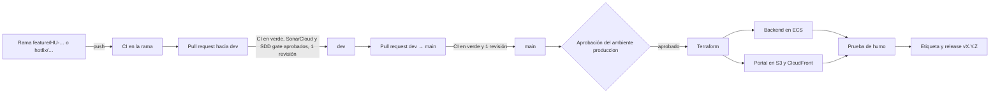

# Proceso de integración y despliegue continuos

Cómo se construye, se prueba, se revisa y se despliega Solventa, y qué condiciones debe cumplir un cambio
en cada paso. Plataforma: GitHub (repositorio, pull requests, Actions y Projects) y AWS (Terraform, ECR,
ECS Fargate, RDS, S3 y CloudFront).

## Recorrido de un cambio

## Ramas y versiones

| Rama | Para qué | Se integra en | Cómo |
|---|---|---|---|
| `feature/HU-…-slug` | Una historia del tablero, con su paquete en `specs/` | `dev` | Pull request con CI en verde y una revisión de otro integrante |
| `fix/HU-…-slug` | Corrección de una historia aún no publicada | `dev` | Igual que una historia |
| `hotfix/slug` | Corrección urgente o de proceso | `dev`, y luego `main` | Pull request; el paquete de spec es obligatorio si toca una ruta crítica |
| `dev` | Integración del sprint | `main` | Pull request de release al cerrar una entrega |
| `main` | Lo que está en producción | — | Cada fusión dispara el despliegue, con aprobación |

Al cerrar cada entrega se etiqueta `main` con `vX.Y.Z` y se publica la release con la sección del
`CHANGELOG.md`. El detalle del flujo está en la página GitFlow de la wiki y en `sdd/rules/git.md`.

## Integración continua

Archivo: `.github/workflows/ci.yml`. Corre en cada push y en cada pull request, con permisos de solo lectura
sobre el repositorio.

| Trabajo | Qué verifica | Evidencia que deja |
|---|---|---|
| Backend CI | Pruebas unitarias y de integración con pytest contra PostgreSQL 16 | Resumen de pruebas en la ejecución, reporte JUnit `junit-backend` y cobertura `coverage-backend` |
| Web CI | Pruebas con Vitest y compilación de producción del portal | Resumen de pruebas, reporte JUnit `junit-web` y cobertura `coverage-web` |
| Mobile CI | Pruebas de la app: unitarias, Robolectric, Compose UI y MockWebServer | Resumen de pruebas, reporte JUnit `junit-movil` y cobertura Kover `coverage-movil` |
| Terraform CI | Formato y validez de la infraestructura | Resultado de `terraform fmt -check` y `terraform validate` |
| SonarCloud | Calidad, seguridad y cobertura del código nuevo con el quality gate «Sonar way» (cobertura ≥ 80 %, duplicación ≤ 3 %, calificaciones A) | Análisis por rama y por pull request en SonarCloud |
| SDD gate | Paquetes de spec, secretos, rutas críticas y dependencias | Resultado del validador `sdd/tools/sdd.py gate` |

El resumen de pruebas de cada componente aparece en la página de la ejecución (pestaña **Summary**): total,
aprobadas, fallidas y omitidas, y el nombre de cada prueba que falló. Lo genera `scripts/ci/junit_summary.py`
a partir de los reportes JUnit que ya producen pytest, Vitest y Gradle, sin acciones de terceros.

## Condiciones para fusionar

Reglas de protección que deben estar activas en GitHub (**Settings → Branches**):

| Regla | `dev` | `main` |
|---|---|---|
| Exigir pull request antes de fusionar | Sí | Sí |
| Aprobaciones requeridas | 1, de alguien distinto del autor | 1 |
| Descartar aprobaciones al subir nuevos commits | Sí | Sí |
| Checks obligatorios en verde | Backend CI, Web CI, Mobile CI, Terraform CI, SonarCloud, SDD gate | Los mismos |
| Rama actualizada con la base antes de fusionar | Sí | Sí |
| Bloquear force push y borrado | Sí | Sí |

## Despliegue continuo

Archivo: `.github/workflows/deploy.yml`. Se dispara con cada fusión en `main` o a mano desde Actions.

1. **Control de rama.** Si la ejecución no viene de `main`, no se despliega nada.
2. **Aprobación.** El trabajo de infraestructura usa el ambiente `produccion`, que exige la aprobación de
   un revisor autorizado y solo admite la rama `main` (**Settings → Environments → produccion**).
3. **Infraestructura.** Terraform aplica la configuración con el estado remoto en S3.
4. **Backend.** Se construye la imagen, se publica en ECR, se actualiza el servicio de ECS y se espera a que
   quede estable.
5. **Portal.** Se compila, se sincroniza con S3 y se invalida la caché de CloudFront.
6. **Prueba de humo.** `scripts/ci/smoke_test.py` hace solo peticiones GET, sin credenciales: el portal
   responde, `/health` del backend responde `healthy` y una ruta de `/api` llega al backend. Si algo falla,
   la ejecución queda en rojo; el resultado se ve en el resumen de la ejecución.

Las credenciales de AWS y las llaves del backend son secretos del repositorio en GitHub; nunca se
escriben en el código ni en los registros.

## Apagado y recreación de la infraestructura

Para no generar costos entre entregas, la infraestructura se destruye con el flujo
`.github/workflows/destroy.yml`, que se lanza a mano y exige escribir `DESTRUIR` para confirmar. Se
recrea lanzando a mano el despliegue desde `main`, que pasa por la misma aprobación y la misma prueba de humo.

## Evidencias

| Qué | Dónde |
|---|---|
| Ejecuciones del CI y sus resúmenes de pruebas | https://github.com/proyectos-miso/proyecto-final-miso/actions/workflows/ci.yml |
| Despliegue exitoso a AWS | https://github.com/proyectos-miso/proyecto-final-miso/actions/runs/40032353896 |
| Apagado de la infraestructura | https://github.com/proyectos-miso/proyecto-final-miso/actions/runs/40034396667 |
| Pull requests revisados y fusionados | https://github.com/proyectos-miso/proyecto-final-miso/pulls?q=is%3Apr+is%3Amerged |
| Calidad y cobertura | https://sonarcloud.io/project/overview?id=proyectos-miso_proyecto-final-miso |
| Releases | https://github.com/proyectos-miso/proyecto-final-miso/releases |
