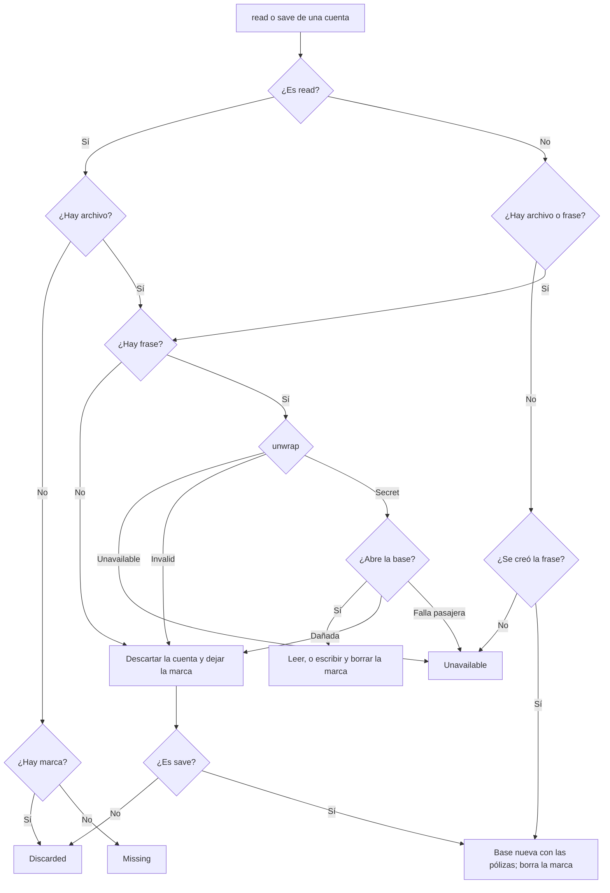

# HU-MOV-05 · Copia cifrada

| Field | Value |
|---|---|
| ID | HU-MOV-05 |
| Title | Copia cifrada |
| User story | https://github.com/proyectos-miso/proyecto-final-miso/issues/71 |
| Owner | David Gutiérrez |
| Status | IN_PROGRESS |
| Created | 2026-10-25 |
| Security profile | HIGH |

## 1. Requirements

### User story

**HU-MOV-05 · Mantener cifrada la copia local de mis pólizas** (Sprint 2, Must have, 2 puntos, FE-MOV-03, ESC-SEG-04; depende de HU-MOV-04).

**Como** cliente asegurado **quiero** que la copia de mis pólizas guardada en el teléfono esté cifrada **para** que solo yo pueda leerla aunque pierda el dispositivo.

Criterios de aceptación de la historia:

1. **Base cifrada.** *Dada* la copia local de pólizas, *cuando* se guarda en el teléfono, *entonces* la base de datos está cifrada con SQLCipher.
2. **Llave protegida.** *Dada* la llave de la base, *cuando* se genera, *entonces* queda protegida por el Android Keystore y nunca se guarda en texto plano.
3. **Ilegible fuera de la app.** *Dado* el archivo de la base extraído del teléfono, *cuando* se intenta abrir sin la llave, *entonces* no se puede leer.
4. **Llave invalidada.** *Dada* una llave inválida o perdida, *cuando* se abre la app, *entonces* se descarta la copia local y se vuelve a descargar al tener conexión.

Requisitos no funcionales: HA-06 (autenticación robusta y biometría fuerte), HA-16 (proteger los datos personales almacenados, #46). Mockup: no aplica; ocurre en segundo plano, sin pantalla propia. Tareas: #192 integración de SQLCipher con Room y llave en Keystore, #193 manejo de llave inválida y regeneración de la base, #194 pruebas de cifrado y de apertura sin llave.

### Problem and outcome

HU-MOV-04 ya guarda la copia en una base SQLCipher por cuenta, con su frase envuelta por una llave del Keystore (ADR 0021). Pero hoy:

- `save` lanza con una base dañada y la app se cierra en cada apertura con red; `read` sí la descarta.
- `read` atrapa cualquier `RuntimeException`: una cancelación (rotar el teléfono) o una falla pasajera borran una copia válida.
- Una frase dañada o una falla del Keystore, incluido el borrado de la llave, cierran la app.
- `unwrap` devuelve `null` igual con la llave inválida que con el teléfono bloqueado.
- Tras descartar la copia, la billetera dice que falta conexión "por primera vez".
- En Android 12 o superior, `allowBackup="false"` no frena la transferencia entre teléfonos (vacío 3 de ADR 0017).
- Cerrar sesión durante una descarga deja que el guardado recree la copia.

Resultado: solo una invalidez real descarta la copia, sin cerrar la app y con un aviso; nada más la borra; y ningún dato de la app sale del teléfono.

### Goals and non-goals

Objetivos: completar el criterio 4 (#193) y verificar los cuatro con pruebas (#194). Los criterios 1 a 3 los implementa HU-MOV-04 en el PR #211 (aclaraciones de Juan Camilo Peña, 2026-10-22 y 2026-10-25); este PR cierra #192 con la evidencia de T-01. HA-06 no cambia: la base abre sin biometría (ADR 0021) y el acceso sin red ya pide la huella (HU-MOV-04).

Dependencias y entrega: la rama parte de `feature/HU-MOV-06-ultima-sincronizacion` porque #211 y #213 siguen abiertos; el PR apunta allí hasta que se fusionen y luego a `dev`, y se reverifican las líneas de los controles EXISTING. Un PR con dos commits de producto: almacén, llaves y billetera (AC-04 a AC-08, AC-10 a AC-13), y reglas de extracción con las ADR (AC-09).

Decisiones de David Gutiérrez (2026-10-25):

- AC-09 excluye todos los datos de la app, incluida la sesión guardada.
- El bloqueo del teléfono se distingue aquí y no en HU-MOV-07.
- La carrera al cerrar sesión, falla previa de HU-MOV-04, se corrige aquí (AC-12).

Fuera de alcance: sincronizar al volver la red (HU-MOV-07); rotar la llave o la frase; cambiar el cifrado; cambiar el identificador de cuenta de ADR 0021 por un HMAC; el código de `data/session` (HU-MOV-03) y los demás vacíos de ADR 0017.

### Affected paths

| Path | Change |
|---|---|
| movil/app/src/main/java/com/solventa/app/domain/policies/PolicyCard.kt | `StoredCopy` en `PolicyStore.read` |
| movil/app/src/main/java/com/solventa/app/data/policies/** | Descarte, regeneración, marca, turnos por cuenta y llaves que no lanzan |
| movil/app/src/main/java/com/solventa/app/ui/wallet/** | Avisos de copia descartada y no disponible, `retry` y `close` |
| movil/app/src/main/java/com/solventa/app/MainActivity.kt | Cerrar la billetera antes de confirmar el cierre de sesión |
| movil/app/src/main/java/com/solventa/app/SolventaApplication.kt | Bloqueo del teléfono en `KeystoreWalletKeys` y registros de SQLCipher apagados |
| movil/app/src/main/res/values/strings.xml | Textos nuevos |
| movil/app/src/main/AndroidManifest.xml | `android:dataExtractionRules` |
| movil/app/src/main/res/xml/data_extraction_rules.xml | Exclusiones de copias y transferencias |
| movil/app/src/test/** | Pruebas unitarias; correos de prueba en `example.com` |
| movil/app/src/androidTest/** | Pruebas instrumentadas y sus dobles; correos de prueba en `example.com` |
| docs/adr/0021-mobile-encrypted-local-database.md | Recuperación y corrección del impacto de `allowBackup` |
| docs/adr/0017-mobile-credential-storage.md | Vacío 3 cerrado |

### Use cases

| ID | Actor | Use case | Main flow | Alternate flows |
|---|---|---|---|---|
| UC-01 | Asegurado | Abrir la billetera con la llave inválida o perdida | 1. Abre la app sin red. 2. El Keystore confirma que la llave no existe o se invalidó. 3. La app borra la copia de esa cuenta y avisa hasta la siguiente descarga | Con red: descarga y guarda una copia nueva, sin aviso |
| UC-02 | Asegurado | Abrir la billetera con una base dañada | 1. Abre la app con red. 2. La base no abre. 3. La app la reemplaza con las pólizas recibidas | Sin red: igual que UC-01 |
| UC-03 | Asegurado | Cambiar de teléfono | 1. Pasa sus datos al teléfono nuevo. 2. No viaja nada de la app. 3. Entra con contraseña y código (HU-MOV-02) | Sin red no puede entrar: no hay cuentas vinculadas |
| UC-04 | App | Usar la copia sin la llave disponible | 1. El teléfono está bloqueado o hay una falla pasajera. 2. El almacén responde "no disponible" sin borrar. 3. La billetera ofrece reintentar y vuelve a leer al regresar a la app | La llave es inválida con el teléfono desbloqueado: UC-01 |
| UC-05 | App | Cancelar una lectura o un guardado | 1. La actividad se recrea al rotar el teléfono. 2. La operación se cancela. 3. Nada se borra y la base abre con su frase | — |
| UC-06 | Asegurado | Cerrar sesión durante una descarga | 1. Confirma el cierre antes de que termine la descarga. 2. La app la cancela y borra la copia | El guardado ya escribía: el borrado espera y borra después |

### Abuse cases

| ID | Abuse case | Actor | Threat | Expected response | Test case |
|---|---|---|---|---|---|
| AB-01 | Abrir sin la llave la base extraída de un teléfono perdido | Quien tenga el teléfono | THR-01 | No es SQLite legible ni abre sin la frase | TC-01 |
| AB-02 | Dañar la base para que la app se cierre en cada apertura | Malware o root | THR-02 | La base se descarta y se regenera; la app no se cierra | TC-03 |
| AB-03 | Transferir los datos a un dispositivo propio desde el teléfono desbloqueado | Quien tenga el teléfono | THR-03 | No viaja ningún archivo de la app | TC-08, TC-09 |
| AB-04 | Reemplazar la base de una cuenta por la de otra | Otro usuario del teléfono | THR-04 | No abre, se descarta solo esa y la otra queda intacta | TC-10 |

### Acceptance criteria

| ID | Criterion | Source |
|---|---|---|
| AC-01 | WHEN la copia se guarda, THE app SHALL cifrarla con SQLCipher | STATED |
| AC-02 | WHEN se genera la llave de la base, THE app SHALL protegerla con el Android Keystore y nunca guardarla en claro | STATED |
| AC-03 | IF el archivo de la base se extrae del teléfono, THE archivo SHALL no poder leerse sin la llave | STATED |
| AC-04 | IF la llave es inválida o se perdió, WHEN se abre la app, THE app SHALL descartar la copia y volver a descargarla con conexión | STATED |
| AC-05 | IF la base está dañada al guardar, THE app SHALL reemplazarla por una nueva con las pólizas recibidas, sin cerrarse | DERIVED: hoy `save` lanza y la app se cierra en cada apertura con red |
| AC-06 | IF la frase está dañada o el Keystore confirma que la llave no existe o se invalidó, THE app SHALL tratarlo como AC-04; ante cualquier otra falla del Keystore o de la base, THE almacén SHALL responder "no disponible" sin descartar; la app SHALL no cerrarse nunca | DERIVED: hoy esos errores cierran la app, y una falla pasajera no debe borrar la única copia que sirve sin red |
| AC-07 | WHILE el teléfono está bloqueado, THE almacén SHALL responder "no disponible" sin descartar, y THE billetera SHALL volver a leer al regresar a la app | DERIVED: la llave solo funciona desbloqueada (ADR 0021); con el servidor caído la lectura espera hasta 20 s; HU-MOV-07 sincroniza en segundo plano |
| AC-08 | WHEN se descartó una copia que existía y no hay red, THE billetera SHALL avisar que por seguridad se borró y se descargará con conexión, hasta la siguiente sincronización exitosa; una cuenta que nunca tuvo copia SHALL no ver ese aviso | DERIVED: hoy dice "por primera vez" |
| AC-09 | THE app SHALL dejar todos sus datos fuera de las copias de seguridad y de las transferencias a otro dispositivo | DERIVED: `sdd/rules/mobile.md` (MASVS-STORAGE-2) y vacío 3 de ADR 0017; alcance decidido el 2026-10-25 |
| AC-10 | WHEN se descarta la copia de una cuenta, THE app SHALL conservar las de las demás cuentas | DERIVED: el teléfono admite varias cuentas (HU-MOV-01) |
| AC-11 | IF una lectura o un guardado se cancelan, THE almacén SHALL dejar todo como estaba y la base SHALL seguir abriendo con su frase | DERIVED: hoy la cancelación borra la copia, y Room puede seguir usando la frase después de ponerla en cero |
| AC-12 | WHEN se confirma el cierre de sesión durante una descarga o un guardado, THE app SHALL no dejar copia de esa cuenta | DERIVED: hoy el guardado puede llegar después del borrado; decisión del 2026-10-25 |
| AC-13 | WHEN la copia no está disponible sin red con el teléfono desbloqueado, THE billetera SHALL decir que no se pudo abrir y ofrecer reintentar | DERIVED: sin descarte (AC-06) hace falta un estado propio en lugar de una carga sin fin |

### Quality requirements

| ID | Category | Requirement | Target and conditions |
|---|---|---|---|
| QR-01 | ACCESSIBILITY | Los dos avisos nuevos y el botón Reintentar funcionan con TalkBack y fuente grande | Guías de accesibilidad de Android: se anuncian al aparecer, el botón mide al menos 48 dp y nada se corta con la fuente al máximo |

### Security triggers

| Trigger | Applies | Rationale |
|---|---|---|
| Personal data (identifies or can identify a person) | YES | Pólizas con el nombre del titular; correo y nombre en la sesión guardada |
| Sensitive data (special categories, biometrics, health, financial, minors) | NO | Coberturas y sumas aseguradas, sin salud, cuentas ni tarjetas |
| Authentication, sessions, credentials or one-time codes | YES | AC-09 cambia adónde puede ir la credencial guardada y el ingreso en un teléfono nuevo |
| Authorization or access to other users' resources | NO | El aislamiento por cuenta de HU-MOV-04 no cambia |
| Payments or money movement | NO | No aplica |
| Third-party services or integrations | NO | No aplica |
| Infrastructure, network, IAM, CI/CD or secrets | NO | No aplica |
| Multiple tenants, partners or organizations | NO | Canal del asegurado |
| Storage or processing on a mobile device | YES | Base, frase y llave en el teléfono |
| Web UI or data exposed in the browser | NO | Solo app móvil |
| New or updated dependencies | NO | Sin dependencias nuevas |
| Critical paths (sdd/security/critical-paths.md) | YES | `AndroidManifest.xml` (HIGH), `SolventaApplication.kt` y `MainActivity.kt` (MEDIUM) |

### Security requirements

| ID | Requirement | Source | Controls | Priority |
|---|---|---|---|---|
| SR-01 | La copia vive en una base SQLCipher por cuenta y su frase solo existe envuelta por el Keystore | DATA-01, DATA-02, THR-01 | CTL-01 | HIGH |
| SR-02 | Solo una invalidez real descarta, y solo la cuenta afectada; ninguna falla cierra la app | DATA-01, DATA-02, THR-02, THR-04 | CTL-02, CTL-04 | MEDIUM |
| SR-03 | Ningún archivo de la app sale del teléfono en copias ni transferencias | DATA-01, DATA-02, DATA-03, THR-03 | CTL-03 | MEDIUM |
| SR-04 | El bloqueo y las fallas pasajeras no descartan, y la billetera vuelve a leer | DATA-01, THR-05, THR-08 | CTL-05, CTL-09 | MEDIUM |
| SR-05 | La frase, la llave y la ruta de la base no se registran, y la frase se pone en cero siempre, después de que la base la usó | DATA-02, THR-06, THR-09 | CTL-06, CTL-07 | HIGH |
| SR-06 | Una cancelación no descarta ni deja una base cifrada con ceros | DATA-01, THR-07, THR-09 | CTL-08 | MEDIUM |
| SR-07 | Ningún guardado posterior al cierre de sesión deja copia | DATA-01, THR-10 | CTL-10 | MEDIUM |

## 2. Design

### Components

En las capas de ADR 0013 y el almacén de ADR 0021, sin carpetas nuevas.

- **`PolicyStore`** (`domain/policies/PolicyCard.kt`): `read` devuelve `StoredCopy` (`Found`, `Missing`, `Discarded`, `Unavailable`); `save` y `delete` nunca lanzan, salvo la cancelación.
- **`KeystoreWalletKeys(isDeviceLocked, keyStore)`** (`data/policies/WalletKeys.kt`): `unwrap` devuelve `Unwrapped` (`Secret`, `Invalid`, `Unavailable`), `wrap` devuelve `null` si no puede y `delete` nunca lanza. Bloqueado antes o después de un fallo da `Unavailable`; `Invalid` solo con alias inexistente, `KeyPermanentlyInvalidatedException`, `AEADBadTagException`, `InvalidAlgorithmParameterException` o `IllegalBlockSizeException`; cualquier otra excepción da `Unavailable`. `keyStore` se inyecta para probar sus fallas.
- **`PassphraseVault`**: `existing` da `Invalid` con Base64 inválido, IV distinto de 12 bytes o texto cifrado de menos de 16; `create` devuelve `null` y pone la frase en cero si `wrap` falla. Guarda la marca de copia descartada por cuenta (`<id>.discarded`), que `delete` borra.
- **`EncryptedPolicyStore`**:
  - Turnos: un `Mutex` por cuenta. `read` y `save` comprueban `ensureActive()` al tomar el turno, antes de cualquier efecto, y hacen el resto en `NonCancellable`; `delete` hace todo en `NonCancellable`, incluida la espera. `NonCancellable` envuelve el cambio a `Dispatchers.IO`.
  - `withDatabase`: construye, usa y cierra la base sin cancelación; un `finally` exterior pone la frase en cero.
  - Base dañada: `SQLiteNotADatabaseException`, `SQLiteDatabaseCorruptException` o el `IllegalStateException` de la verificación de integridad de Room; la cancelación se relanza antes de clasificar. Cualquier otro error es pasajero. El tipo exacto de SQLCipher se confirma con la prueba de base alterada.
  - `read`: sin archivo, solo consulta la marca. Con invalidez real descarta y deja la marca (`Discarded`); con falla pasajera o bloqueo, `Unavailable` sin borrar.
  - `save`: bloqueado o con falla pasajera no hace nada; con invalidez real descarta, deja la marca y escribe una base nueva; en el primer guardado, si no puede escribir, borra lo creado sin marca. Un guardado exitoso borra la marca.
  - Sin registros propios.
- **`SolventaApplication`**: pasa `KeyguardManager.isDeviceLocked` y apaga los registros de SQLCipher (`net.zetetic.database.Logger`, `NoopTarget`).
- **`WalletViewModel`**: sin red, `Found` muestra la copia, `Missing` pide conexión, `Discarded` pide conexión con `copyDiscarded` y `Unavailable` muestra `copyUnavailable`. `retry()` vuelve a leer; `refreshClock` también, antes de su guarda de carga. `close()` cancela `loadJob` y reinicia el estado.
- **`WalletScreen`**: `WarningBanner` con `ic_lock` para `copyDiscarded` y `WarningBanner` con botón Reintentar para `copyUnavailable`.
- **`MainActivity`**: el diálogo de cierre de sesión llama `walletViewModel.close()` y después `viewModel.confirmLogout()`.
- **Textos**: `wallet_copy_discarded` = "Por seguridad se borró la copia de sus pólizas en este teléfono. Se descargará de nuevo cuando tenga conexión a internet."; `wallet_copy_unavailable` = "No se pudo abrir la copia de sus pólizas en este teléfono. Intente de nuevo."; `wallet_retry` = "Reintentar".
- **Reglas de extracción**: `android:dataExtractionRules` en el manifiesto, conservando `allowBackup="false"`. En `<cloud-backup>`, `<device-transfer>` y `<cross-platform-transfer platform="ios">`, un `<exclude path="."/>` por dominio: `root`, `file`, `database`, `sharedpref`, `external`, `device_root`, `device_file`, `device_database` y `device_sharedpref`. Va uno por dominio porque Android recorre cada uno por separado.
- **Pruebas**: `InMemoryPolicyStore` simula `Discarded` y `Unavailable`; `androidTest` tiene sus propios dobles de llaves.

### Data flows

La frase cruza el límite del Keystore; la base, la frase envuelta y la marca viven en el almacenamiento privado; nada cruza el límite de copias y transferencias (CTL-03).

### Data contract

Sin cambios en el API. Cambia el puerto `PolicyStore` (ADR 0013), que lleva DATA-01 (CONFIDENTIAL):

| Operación | Resultado | Significado |
|---|---|---|
| `read(accountEmail)` | `Found(copy)` | Copia y hora de su sincronización |
| | `Missing` | La cuenta no tiene copia |
| | `Discarded` | Se borró una copia que existía y aún no hay una sincronización exitosa |
| | `Unavailable` | Teléfono bloqueado o falla pasajera; la copia se conserva |
| `save(accountEmail, policies, syncedAt)` | Sin valor | Guarda o regenera; si no puede, conserva la anterior |
| `delete(accountEmail)` | Sin valor | Borra la copia, la frase, la llave y la marca |

### Security design decisions

| Decision | Implements | Rejected alternative and why |
|---|---|---|
| Consultar el bloqueo antes de usar la llave y después de un fallo | CTL-05, CRY-02 | Por tipo de excepción: varía entre versiones y fabricantes |
| Descartar solo ante invalidez real; lo demás es "no disponible" | CTL-02, CTL-09 | Descartar ante cualquier falla: borraría la única copia que sirve sin red |
| Turno por cuenta, `ensureActive()` antes de cualquier efecto y el resto sin cancelación | CTL-07, CTL-08, CTL-10 | Atrapar la cancelación: Room sigue en su hilo y la frase se pondría en cero mientras SQLCipher la usa |
| `save` y `delete` no lanzan | CTL-02 | Propagar: cierra la app |
| Marca de descarte solo si la copia existía | CTL-02 | Sin marca, la segunda apertura volvería a decir "por primera vez"; marcar siempre avisaría a cuentas nuevas |
| Cerrar la billetera antes de confirmar el cierre de sesión | CTL-10 | Solo cancelar la carga: un guardado en curso terminaría después del borrado |
| Excluir los nueve dominios en las tres secciones y conservar `allowBackup="false"` | CTL-03 | Excluir solo `root`: los demás dominios seguirían viajando |
| Sin registros y frase en cero en `finally` | CTL-06, CTL-07 | Registrar para depurar: expone rutas y datos de la cuenta |

### Architecture decisions

| ADR | Title | Status |
|---|---|---|
| `docs/adr/0021-mobile-encrypted-local-database.md` | Mobile: an encrypted local database per account with Room and SQLCipher | Proposed; se actualiza la decisión 4 (recuperación) y el impacto de `allowBackup` |
| `docs/adr/0017-mobile-credential-storage.md` | Mobile: credentials protected by the Keystore and biometrics; tokens only in memory | Se marca cerrado el vacío 3 |

Se actualiza la ADR 0021 en vez de escribir otra porque sigue en Proposed y deja este manejo a HU-MOV-05.

### Configuration and deployment

Sin variables nuevas; igual en debug y release. Las pruebas instrumentadas y la de transferencia no corren en el CI (ADR 0021): se ejecutan en un teléfono y su resultado queda en `gate.md`.

### Screens

Billetera, sin pantallas nuevas. Dos estados nuevos sin red: copia descartada (aviso con candado en lugar del de primera descarga) y copia no disponible (aviso con botón Reintentar). `WarningBanner` se anuncia con TalkBack (`liveRegion`) y crece con la fuente (QR-01).

## 3. Tasks

| ID | Task | Traces to | Controls | Status | Evidence |
|---|---|---|---|---|---|
| T-01 | Verificar con pruebas lo que entregó HU-MOV-04 (#192), reutilizando `EncryptedPolicyStoreTest` y `PassphraseVaultTest` | AC-01, AC-02, AC-03, SR-01 | CTL-01 | TODO | — |
| T-02 | Almacén: descarte solo ante invalidez real, regeneración, marca, turnos por cuenta, sin registros y frase en cero (#193) | AC-04, AC-05, AC-06, AC-10, AC-11, SR-02, SR-05, SR-06 | CTL-02, CTL-04, CTL-06, CTL-07, CTL-08, CTL-09 | IN_PROGRESS | — |
| T-03 | Llaves: bloqueo y fallas pasajeras como "no disponible" y nueva lectura al volver (#193) | AC-06, AC-07, SR-04 | CTL-05, CTL-09 | IN_PROGRESS | — |
| T-04 | Billetera: avisos de copia descartada y no disponible (#193) | AC-08, AC-13, QR-01 | CTL-02, CTL-09 | IN_PROGRESS | — |
| T-05 | Reglas de extracción, en su propio commit | AC-09, SR-03 | CTL-03 | IN_PROGRESS | — |
| T-06 | Actualizar las ADR 0021 y 0017 | AC-04, AC-09, SR-02, SR-03 | CTL-02, CTL-03 | IN_PROGRESS | — |
| T-07 | Pruebas en el CI y en el teléfono, y evidencia en `gate.md` (#194) | AC-01, AC-04, AC-05, AC-06, AC-07, AC-08, AC-09, AC-10, AC-11, AC-12, AC-13, QR-01, SR-01, SR-02, SR-03, SR-04, SR-05, SR-06, SR-07 | CTL-01, CTL-02, CTL-03, CTL-04, CTL-05, CTL-06, CTL-07, CTL-08, CTL-09, CTL-10 | TODO | — |
| T-08 | Cerrar la billetera antes de confirmar el cierre de sesión | AC-12, SR-07 | CTL-10 | IN_PROGRESS | — |
