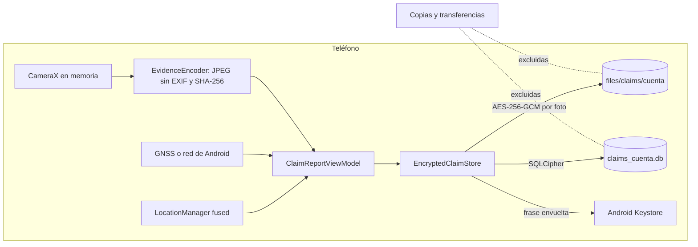

# HU-MOV-08 · Evidencia fotográfica

| Field | Value |
|---|---|
| ID | HU-MOV-08 |
| Title | Evidencia fotográfica |
| User story | https://github.com/proyectos-miso/proyecto-final-miso/issues/74 |
| Owner | David Gutiérrez |
| Status | IN_REVIEW |
| Created | 2026-11-05 |
| Security profile | HIGH |

<!-- A spec is a contract: what, why, how, and how we will know it is done. Fill the sections in
     order and stop for agreement between them: Requirements → Design → Tasks.
     Status: DRAFT → READY (after spec-review) → IN_PROGRESS → IN_REVIEW → DONE | BLOCKED. -->

## 1. Requirements

### User story

**HU-MOV-08 · Capturar evidencia fotográfica con ubicación y hora** (Sprint 3, Must have, 3 puntos, FE-MOV-06, ESC-SEG-03; depende de HU-MOV-01).

**Como** cliente asegurado **quiero** reportar un siniestro capturando fotografías con la ubicación y la hora incorporadas **para** aportar evidencia desde el lugar de los hechos sin depender de un perito.

Criterios de aceptación de la historia:

1. **Fotos con ubicación y hora.** *Dado* un asegurado que reporta un siniestro, *cuando* toma una foto desde la app, *entonces* la foto queda asociada a la ubicación y la hora del momento de la captura.
2. **Solo fotos del momento.** *Dado* el reporte, *cuando* el asegurado agrega evidencia, *entonces* solo puede usar la cámara, no fotos de la galería, para que la ubicación y la hora sean confiables.
3. **Permiso de ubicación negado.** *Dado* que el asegurado no concede la ubicación, *cuando* intenta tomar la foto, *entonces* la app explica para qué se necesita y cómo concederla, sin cerrarse.
4. **Reporte completo.** *Dado* el formulario, *cuando* el asegurado elige la póliza, describe lo ocurrido y adjunta entre 1 y 5 fotos, *entonces* puede enviar el reporte; sin foto o sin descripción, la app dice qué falta.
5. **Evidencia protegida.** *Dadas* las fotos tomadas, *cuando* quedan en el teléfono antes de enviarse, *entonces* se guardan cifradas dentro de la app y no aparecen en la galería.

Requisitos no funcionales: HA-15 (proteger los datos personales en transmisión, #45), HA-16 (proteger los datos personales almacenados, #46), HA-17 (hacer inmutables los registros cerrados, #47).

Mockup, 6 pantallas: 1. billetera con el botón «Reportar un siniestro»; 2. cámara del reporte con ubicación y hora, sin galería; 3. permiso de ubicación negado, con su necesidad y cómo concederlo; 4. evidencia con 1 a 5 fotos, cada una con su ubicación y hora; 5. detalle con póliza y descripción, con aviso de lo que falta; 6. envío y radicación del reporte.

Tareas: #231 pantalla de reporte con selección de póliza, descripción y cámara (CameraX); #232 ubicación y hora de la captura, con manejo de permisos negados; #233 almacenamiento cifrado de las fotos dentro de la app; #234 pruebas unitarias y de pantalla del reporte y de los permisos.

Pendientes de rutas críticas (`specs/pendientes/HU-MOV-08.md`): **RC-11** (J3, HA-15), las fotos del siniestro no están protegidas en tránsito; HTTPS de punta a punta (depende de RC-31) y un hash por foto calculado en el teléfono y verificado al recibirla.

### Problem and outcome

Hoy el asegurado no puede reportar un siniestro desde la app: la billetera solo muestra sus pólizas. El reporte depende de un perito o de otros canales, y una foto sacada de la galería no prueba dónde ni cuándo se tomó. Resultado: desde la billetera el asegurado abre el reporte, elige la póliza, describe lo ocurrido y toma de 1 a 5 fotos con la cámara de la app. Cada foto queda con su ubicación, su hora y su huella, cifrada dentro de la app y fuera de la galería, y el reporte completo queda guardado y listo para enviarse.

### Goals and non-goals

Objetivos:
- Reportar desde la billetera: una póliza vigente de la copia de la cuenta (también sin red), la descripción y de 1 a 5 fotos.
- Fotos solo con la cámara de la app, cada una con ubicación, hora del teléfono, hora de la ubicación, marca de ubicación simulada y huella SHA-256.
- Explicar el permiso de cámara o de ubicación negado y la ubicación apagada o sin señal, sin cerrar la app ni perder el reporte.
- Reporte y fotos cifrados, uno por cuenta, que sobreviven al cierre de la app y al vencimiento de la sesión, y se borran al cerrar sesión, al cambiar la contraseña o cuando el servidor desvincula el teléfono.

Fuera de alcance:
- Enviar el reporte, la cola sin señal, el radicado y la lista de siniestros: HU-MOV-09, HU-MOV-10 y HU-MOV-11.
- Verificar la huella al recibir la foto (RC-11): la recepción es de HU-MOV-09 (#237, «carga de las fotos a S3 con su huella»), así que aquí solo se calcula y se guarda. El cifrado en tránsito depende de RC-31.
- El certificate pinning y el canal TLS que muestra el mockup 6: van con el envío (HU-MOV-09) y con RC-31.
- Videos, audio, documentos y fotos de la galería; editar o recortar fotos.
- Detectar montajes o fotos de una pantalla y el antifraude del lado del servidor (HU-WEB-15).
- Mostrar la dirección en lugar de las coordenadas: la geocodificación usa un servicio de Google y no funciona sin red (DEC-07).
- La barra inferior de la app (Billetera, Siniestros, Mi cuenta) del mockup 1: llega con la pestaña Siniestros de HU-MOV-11.
- Un título por foto como en el mockup 4 («Daño lateral izquierdo»): las fotos se numeran y la descripción cuenta lo ocurrido.
- Navigation Compose: el reporte sigue la navegación por estado de la ADR 0015, enmendada; el cambio llega con HU-MOV-11 (DEC-10).

### Affected paths

| Path | Change |
|---|---|
| movil/gradle/libs.versions.toml | CameraX |
| movil/app/build.gradle.kts | Dependencias de CameraX |
| movil/app/src/main/AndroidManifest.xml | Permisos de cámara y ubicación; la cámara no es obligatoria para instalar la app |
| movil/app/src/main/res/values/strings.xml | Textos del reporte, de la cámara y de los permisos |
| movil/app/src/main/java/com/solventa/app/domain/claims/** | Reporte, evidencia y puertos |
| movil/app/src/main/java/com/solventa/app/data/claims/** | Reporte cifrado, fotos cifradas, ubicación y huella |
| movil/app/src/main/java/com/solventa/app/ui/claims/** | Pantallas del reporte, la cámara, los permisos y la evidencia |
| movil/app/src/main/java/com/solventa/app/ui/wallet/WalletScreen.kt | Botón «Reportar un siniestro» |
| movil/app/src/main/java/com/solventa/app/ui/auth/AuthViewModel.kt | Borra el reporte al cerrar sesión y al cambiar la contraseña |
| movil/app/src/main/java/com/solventa/app/data/policies/SessionPolicySync.kt | Borra el reporte cuando el servidor desvincula el teléfono |
| movil/app/src/main/java/com/solventa/app/data/policies/WalletKeys.kt | `PassphraseVault` recibe el nombre de sus preferencias y el prefijo del alias |
| movil/app/src/main/java/com/solventa/app/MainActivity.kt | Navegación al reporte y protección de capturas (DEC-03) |
| movil/app/src/main/java/com/solventa/app/SolventaApplication.kt | Composición |
| movil/app/src/test/** | Pruebas unitarias y de pantalla en Robolectric |
| movil/app/src/androidTest/** | Prueba del almacén con SQLCipher y el Keystore reales |
| movil/app/schemas/** | Esquema exportado de la base del reporte |
| sdd/security/critical-paths.md | `data/claims/**` como ruta crítica HIGH |
| docs/adr/** | ADR 0024 nueva y enmienda de la ADR 0015 |
| specs/pendientes/HU-MOV-09.md | RC-11: la verificación de la huella al recibir pasa a HU-MOV-09 |

### Use cases

| ID | Actor | Use case | Main flow | Alternate flows |
|---|---|---|---|---|
| UC-01 | Asegurado | Reportar un siniestro con fotos | 1. En la billetera toca «Reportar un siniestro». 2. Toma de 1 a 5 fotos con la cámara de la app; cada una queda con su ubicación y su hora (paso 1). 3. Elige la póliza y describe lo ocurrido (paso 2). 4. Toca «Enviar» | Falta la descripción o la foto: la app dice qué falta. Intenta una sexta foto: la app no la deja. Borra una foto y toma otra. Sin red: arma el reporte con la copia de la billetera |
| UC-02 | Asegurado | Tomar la foto sin permiso de ubicación o de cámara | 1. Toca la cámara. 2. La app pide el permiso. 3. Lo niega. 4. La app explica para qué se necesita y cómo concederlo, con un acceso a los ajustes | Lo niega para siempre: queda el acceso a los ajustes. Vuelve de los ajustes con el permiso: la cámara se abre. Niega la cámara: la misma explicación para la cámara |
| UC-03 | Asegurado | Tomar la foto con la ubicación apagada o sin señal | 1. Toca el disparador. 2. La app muestra que busca la ubicación. 3. Con la ubicación, guarda la foto | La ubicación del teléfono está apagada: explica cómo encenderla. No llega en 30 s: explica que salga a un lugar abierto o lo intente de nuevo, sin perder lo hecho |
| UC-04 | Asegurado | Retomar o descartar un reporte | 1. Sale de la app con el reporte a medias. 2. Vuelve. 3. Encuentra el reporte con sus fotos | Descarta el reporte: se borran sus fotos. Cierra sesión: se borran el reporte y las fotos de esa cuenta. La sesión vence: el reporte sigue al volver a entrar |

### Abuse cases

| ID | Abuse case | Actor | Threat | Expected response | Test case |
|---|---|---|---|---|---|
| AB-01 | Adjuntar una foto vieja, editada o de internet como si fuera del lugar | Asegurado que quiere defraudar | THR-01 | Solo la cámara de la app: sin galería ni apps de cámara de terceros | TC-02 |
| AB-02 | Simular la ubicación con una app de ubicación falsa | Asegurado que quiere defraudar | THR-02 | La foto queda marcada con ubicación simulada | TC-05 |
| AB-03 | Cambiar el reloj del teléfono para falsear la hora | Asegurado que quiere defraudar | THR-03 | Se guardan la hora del teléfono y una hora que no depende de su reloj | TC-05 |
| AB-04 | Sacar las fotos por la galería, el almacenamiento compartido, una copia de seguridad u otra app | Quien tenga el teléfono u otra app | THR-04 | Fotos cifradas en el almacenamiento privado de la app y fuera de las copias de seguridad | TC-06 |
| AB-05 | Cambiar una foto ya tomada por otra en el almacenamiento de la app | Quien tenga root | THR-05 | El cifrado autenticado rechaza el archivo alterado y la huella no coincide | TC-07 |
| AB-06 | Ver el reporte de otra persona en un teléfono compartido | Otra cuenta del mismo teléfono | THR-06 | Un reporte por cuenta, que se borra al cerrar sesión | TC-08 |

### Acceptance criteria

| ID | Criterion | Source |
|---|---|---|
| AC-01 | WHEN el asegurado toma una foto en el reporte, THE app SHALL guardarla con la latitud, la longitud, la precisión y la hora del momento de la captura | STATED |
| AC-02 | THE app SHALL tomar la evidencia solo con la cámara dentro de la app, sin ofrecer la galería ni abrir otras apps de cámara | STATED |
| AC-03 | IF el permiso de ubicación está negado, WHEN el asegurado intenta tomar una foto, THE app SHALL explicar para qué se necesita y cómo concederlo, con un acceso a los ajustes, sin cerrarse y conservando el reporte | STATED |
| AC-04 | WHEN el reporte tiene póliza, descripción y entre 1 y 5 fotos, THE app SHALL habilitar «Enviar»; IF falta la descripción o la foto, THE app SHALL decir qué falta | STATED |
| AC-05 | THE app SHALL guardar las fotos cifradas en el almacenamiento privado de la app, sin que aparezcan en la galería ni en el almacenamiento compartido | STATED |
| AC-06 | WHEN la billetera muestra pólizas vigentes o la cuenta tiene un reporte guardado, THE billetera SHALL ofrecer «Reportar un siniestro», y THE selector SHALL ofrecer solo las pólizas vigentes de la cuenta, también sin conexión | DERIVED: mockup 1 de la historia; el reporte sin señal (HU-MOV-09) solo cuenta con la copia de la billetera, y un reporte guardado debe poder abrirse y descartarse aunque ya no haya pólizas vigentes |
| AC-07 | IF el permiso de cámara está negado, THE app SHALL explicar para qué se necesita y cómo concederlo, igual que con la ubicación | DERIVED: sin cámara no hay evidencia; mismo trato que el criterio 3 |
| AC-08 | IF la ubicación del teléfono está apagada o no llega una ubicación en 30 s, THE app SHALL no tomar la foto, decir cómo resolverlo y conservar el reporte | DERIVED: la historia exige la ubicación en cada foto y el criterio 3 solo cubre el permiso (DEC-01) |
| AC-09 | WHEN se guarda una foto, THE app SHALL calcular su huella SHA-256 y guardarla con ella | DERIVED: RC-11; HU-MOV-09 la verifica al recibir la foto |
| AC-10 | THE app SHALL guardar con cada foto, además de la hora del teléfono, una hora que no dependa del reloj que ajusta la persona (la del GNSS o la de red de Android, cuando el teléfono la tiene), y SHALL marcar la foto si la ubicación es simulada | DERIVED: el reloj del teléfono se puede cambiar (HU-MOV-06) y la ubicación se puede falsear; quien dictamina lo ve en HU-WEB-15 |
| AC-11 | WHILE el reporte no se ha enviado, THE app SHALL conservarlo cifrado con sus fotos aunque la app se cierre o la sesión venza, con a lo sumo un reporte por cuenta, en borrador o listo | DERIVED: perder el reporte obligaría a volver al lugar; varias cuentas pueden usar el mismo teléfono (DEC-08) |
| AC-12 | WHEN la persona cierra sesión, cambia la contraseña o el servidor desvincula el teléfono de la cuenta, THE app SHALL borrar el reporte y las fotos de esa cuenta | DERIVED: las revocaciones explícitas de HU-MOV-04 y HU-MOV-05; el vencimiento de la sesión no borra la evidencia, que no se puede volver a tomar (DEC-08). Un cambio de contraseña hecho en otro teléfono llega aquí como sesión vencida, y el reporte se borra en el siguiente ingreso, cuando el servidor rechaza el teléfono (RISK-04) |
| AC-13 | WHEN el asegurado borra una foto o descarta el reporte, THE app SHALL borrar sus archivos | DERIVED: mockup 4; no deben quedar fotos huérfanas en el teléfono |
| AC-14 | THE descripción SHALL tener entre 1 y 500 caracteres sin contar los espacios de los extremos, y THE app SHALL guardar cada foto en JPEG de a lo sumo 2 MB | DERIVED: límites para enviar por red móvil (HU-MOV-09); 500 caracteres como el mockup 5 |
| AC-15 | WHEN el asegurado toca «Enviar» con el reporte completo, THE app SHALL dejarlo guardado como listo para enviar y avisar que quedó guardado en el teléfono | DERIVED: el envío es de HU-MOV-09, que reemplaza este paso (DEC-02) |
| AC-16 | WHILE se muestra el reporte en una build release, THE app SHALL impedir capturas de pantalla y ocultar su contenido en las apps recientes | DERIVED: las fotos y la descripción pueden mostrar heridas o a terceros (DEC-03) |
| AC-17 | IF la persona concede solo la ubicación aproximada, THE app SHALL tratarlo como permiso negado y explicar que se necesita la ubicación precisa | DERIVED: la ubicación aproximada, de unos 3 km, no ubica el lugar de los hechos (DEC-05) |
| AC-18 | WHEN el asegurado toca «Enviar», THE app SHALL comprobar que la póliza elegida siga vigente en la copia y, si no, pedir otra sin perder el reporte | DERIVED: la póliza puede vencer mientras el reporte está a medias |
| AC-19 | WHILE el reporte está listo para enviar, THE app SHALL mostrarlo sin permitir editarlo y SHALL permitir descartarlo | DERIVED: HA-17; lo que se dejó listo no cambia antes de enviarse |
| AC-20 | THE app SHALL leer la ubicación solo mientras la cámara del reporte está abierta y en primer plano, y SHALL dejar de leerla al salir de la cámara | DERIVED: privacidad de la ubicación; así la ubicación está lista al disparar (DEC-09) |

### Quality requirements

| ID | Category | Requirement | Target and conditions |
|---|---|---|---|
| QR-01 | PERFORMANCE | La foto se guarda rápido | Con la ubicación disponible, la foto queda guardada, cifrada y con su huella en menos de 2 s desde el disparo, en 20 de 20 capturas en el teléfono |
| QR-02 | ACCESSIBILITY | El reporte se usa con TalkBack | Guías de Android: el disparador, «Borrar foto» y los avisos con nombre accesible; destinos táctiles de al menos 48 dp; la explicación del permiso se lee completa con la fuente al máximo |

### Security triggers

| Trigger | Applies | Rationale |
|---|---|---|
| Personal data (identifies or can identify a person) | YES | Ubicación precisa y hora ligadas a la cuenta; fotos que pueden mostrar personas y placas |
| Sensitive data (special categories, biometrics, health, financial, minors) | YES | Las fotos y la descripción pueden mostrar heridas (datos de salud) |
| Authentication, sessions, credentials or one-time codes | YES | El reporte se borra al cerrar sesión, al cambiar la contraseña o cuando el servidor desvincula el teléfono (`AuthViewModel`, `SessionPolicySync`); no cambia el ingreso |
| Authorization or access to other users' resources | NO | Sin servidor en esta historia; el selector usa la copia de la cuenta abierta |
| Payments or money movement | NO | No aplica |
| Third-party services or integrations | NO | Cámara y ubicación del propio Android, sin SDK de terceros; en teléfonos con Google, el proveedor de ubicación del sistema lo implementan los servicios de Google según los ajustes de la persona, fuera de la app |
| Infrastructure, network, IAM, CI/CD or secrets | NO | Sin cambios de infraestructura ni de CI |
| Multiple tenants, partners or organizations | NO | Canal del asegurado |
| Storage or processing on a mobile device | YES | Reporte y fotos cifrados en el teléfono |
| Web UI or data exposed in the browser | NO | Solo móvil |
| New or updated dependencies | YES | CameraX (`androidx.camera`) |
| Critical paths (sdd/security/critical-paths.md) | YES | `**/AndroidManifest.xml` y `**/auth/**` (`ui/auth/AuthViewModel.kt`) (HIGH); `**/*.gradle*`, `**/libs.versions.toml`, `MainActivity.kt` y `SolventaApplication.kt` (MEDIUM); `data/claims/**` se agrega como HIGH |

### Security requirements

<!-- Each SR comes from data (DATA), a threat (THR) or a risk (RISK) in security.md,
     is mitigated by controls (CTL) and verified by at least one security test case (TC). -->

| ID | Requirement | Source | Controls | Priority |
|---|---|---|---|---|
| SR-01 | La evidencia sale solo de la cámara dentro de la app, sin galería, selector de fotos ni apps de cámara de terceros | THR-01, DATA-01 | CTL-01 | HIGH |
| SR-02 | Cada foto guarda una ubicación fresca con su precisión, la marca de simulada y una hora independiente del reloj del teléfono cuando existe | THR-02, THR-03, DATA-03 | CTL-02, CTL-03 | HIGH |
| SR-03 | Fotos, descripción, ubicación y póliza se guardan cifradas por cuenta y nunca en claro en disco, en la galería, en archivos temporales ni en copias de seguridad | THR-04, THR-05, DATA-01, DATA-02, DATA-03, DATA-04, DATA-05 | CTL-04, CTL-05, CTL-06 | HIGH |
| SR-04 | El reporte de una cuenta no se ve desde otra y se borra al cerrar sesión, al cambiar la contraseña o cuando el servidor desvincula el teléfono | THR-06, DATA-01, DATA-02 | CTL-07 | HIGH |
| SR-05 | En release, la ventana del reporte no permite capturas ni muestra su contenido en las apps recientes | THR-07, DATA-01, DATA-02 | CTL-08 | MEDIUM |
| SR-06 | Ni la descripción, ni la ubicación, ni las rutas, ni las llaves quedan en registros o en el estado guardado de la pantalla | THR-08, DATA-02, DATA-03, DATA-05 | CTL-09 | MEDIUM |
| SR-07 | La app pide solo cámara y ubicación precisa, lee la ubicación solo con la cámara del reporte abierta y en primer plano, y trata la aproximada como negada | THR-02, THR-10, DATA-03 | CTL-11 | MEDIUM |
| SR-08 | Cada foto guarda la huella SHA-256 de los bytes que se enviarán, y una foto alterada no se descifra ni se muestra | THR-05, DATA-01 | CTL-04, CTL-13 | MEDIUM |
| SR-09 | Una llave invalidada, una base dañada o el cierre de la app no cierran la app ni borran el reporte sin que la persona lo decida | THR-09, DATA-01, DATA-02 | CTL-10 | MEDIUM |
| SR-10 | El reporte respeta los límites de 5 fotos de 2 MB, 500 caracteres y un reporte por cuenta | THR-11 | CTL-12 | LOW |
| SR-11 | Las dependencias nuevas no tienen vulnerabilidades conocidas | DATA-01 | CTL-14 | MEDIUM |
| SR-12 | La base del reporte exporta su esquema y solo cambia con migraciones que conservan los datos | THR-12, DATA-01, DATA-02 | CTL-15 | HIGH |
| SR-13 | Un reporte guardado siempre se puede abrir y descartar desde la billetera, aunque no haya pólizas vigentes ni copia | THR-13, DATA-01, DATA-02 | CTL-16 | MEDIUM |

## 2. Design

Interfaz: la propuesta 1, fiel a los 6 mockups de la historia (#74): botón en la billetera → cámara → evidencia (paso 1) → detalle (paso 2) → guardado. Se dibujan además los estados que los mockups no cubren: «Buscando ubicación…», cámara negada, ubicación aproximada o apagada y reporte guardado. Se muestran las coordenadas, no la dirección (DEC-07). El botón va debajo del carné, como el mockup 1; cuando la billetera no muestra carnés (copia descartada, sin conexión y sin copia, o sin pólizas) va debajo de su aviso. El lugar y la hora del detalle salen de la primera foto. La hoja del permiso de ubicación dice «La ubicación solo se lee con la cámara del reporte abierta, nunca en segundo plano», en lugar del «Solo se lee al disparar» del mockup 3 (DEC-09).

### Components

**Dominio (`domain/claims`)**
- `ClaimReport`: id, póliza, descripción, estado (`DRAFT` o `READY`), fotos, creado y actualizado.
- `EvidencePhoto`: id, posición, hora del teléfono, hora independiente y su fuente (`GNSS` o `NETWORK`, o vacía), latitud, longitud, precisión, marca de simulada, huella SHA-256 y tamaño.
- Puertos: `ClaimReportStore` (borrador de la cuenta, guardar descripción y póliza, agregar y borrar foto, leer foto, marcar listo, descartar, borrar la cuenta), `CaptureLocator` (ubicación para el disparo) y `TrustedClock` (hora independiente).
- `ClaimRules`: de 1 a 5 fotos, descripción de 1 a 500 caracteres sin los espacios de los extremos, foto de a lo sumo 2 MB; dice qué falta.

**Datos (`data/claims`)**
- `EncryptedClaimStore`: base Room con SQLCipher `claims_<cuenta>.db` y fotos en `files/claims/<cuenta>/<foto>.bin`. Las operaciones de cada cuenta van en serie (un `Mutex` por cuenta, como `EncryptedPolicyStore`) y el borrado no se cancela. La base exporta su esquema a `movil/app/schemas/` y cambia solo con migraciones; nunca usa `fallbackToDestructiveMigration` (ADR 0021, punto 6). Una llave invalidada o una base dañada dejan el reporte como «no se puede abrir» y la persona decide descartarlo; nada se borra solo.
- `PhotoCipher`: AES-256-GCM con una llave aleatoria de 32 bytes y un nonce de 96 bits por foto; la llave y el nonce van en la fila de la foto.
- Llaves: `KeystoreWalletKeys` y `PassphraseVault` de HU-MOV-05, con el nombre de preferencias y el prefijo del alias como parámetros: la billetera conserva `solventa_wallet` y `solventa_wallet_<cuenta>`, y el reporte usa `solventa_claims` y `solventa_claims_<cuenta>`. Una llave por propósito y por cuenta, que exige el teléfono desbloqueado.
- `AndroidCaptureLocator`: `LocationManager` con el proveedor `fused` del sistema o, si el teléfono no lo tiene, `gps` y `network`. Escucha la ubicación cada segundo solo mientras la cámara del reporte está abierta y en primer plano, y se detiene al salir (AC-20); al disparar usa la última si tiene 10 s o menos y precisión de 100 m o menos; si no, espera hasta 30 s. Responde sin permiso, solo aproximada, ubicación apagada, sin ubicación a tiempo o la ubicación con su marca `isMock`.
- `AndroidTrustedClock`: `SystemClock.currentGnssTimeClock()` y, si no hay, `SystemClock.currentNetworkTimeClock()`; si ninguno tiene hora, queda vacía.
- `EvidenceEncoder`: de la imagen de CameraX en memoria a JPEG, girada según el sensor, con el lado mayor de a lo sumo 1920 px y calidad 85, bajando la calidad hasta quedar en 2 MB; `Bitmap.compress` no escribe EXIF. Calcula la huella sobre esos bytes.

**Interfaz (`ui/claims`)**
- `ClaimReportViewModel`: la pantalla actual (evidencia, cámara, detalle, guardado), los permisos, lo que falta y las miniaturas descifradas en memoria. La descripción vive en el ViewModel y en la base, nunca en `rememberSaveable`; se guarda 500 ms después de dejar de escribir.
- `ClaimEvidenceScreen` (paso 1), `ClaimCameraScreen` (CameraX con `PreviewView` de `camera-view` dentro de Compose e `ImageCapture` en memoria), `ClaimPermissionSheet` (ubicación, ubicación precisa o cámara, con acceso a los ajustes), `ClaimDetailScreen` (paso 2) y `ClaimSavedScreen`, que también muestra el reporte listo sin editarlo y permite descartarlo (AC-19).
- `WalletScreen`: botón principal «Reportar un siniestro» debajo del carné, como el mockup 1, o debajo del aviso cuando no hay carnés, si hay una póliza vigente o un reporte guardado; con un reporte guardado lo retoma.
- `MainActivity`: el reporte es una rama más de la navegación por estado (ADR 0015, enmendada); lo muestra desde el estado de la billetera, maneja «atrás» y pone `FLAG_SECURE` mientras el reporte está en pantalla en la build release.
- `AuthViewModel` y `SessionPolicySync`: borran el reporte de la cuenta al cerrar sesión, al cambiar la contraseña y cuando el servidor desvincula el teléfono (`DEVICE_REJECTED`); con la sesión vencida (`EXPIRED`) o al pedir otro ingreso (`RELOGIN`) lo conservan (DEC-08).
- `SolventaApplication`: compone el almacén, la ubicación y el reloj.

### Data flows

Ningún dato cruza la red en esta historia. Los límites de confianza son los sensores de Android, el Keystore, el almacenamiento privado y la pantalla del sistema (`security.md`, sección 4).

### Data contract

No hay API en esta historia; el contrato es la base local, que HU-MOV-09 amplía para la cola.

| Tabla | Campo | Tipo | Regla |
|---|---|---|---|
| `reports` | `id` | TEXT, clave | UUID aleatorio |
| `reports` | `policy_number` | TEXT | Una póliza vigente de la copia de la cuenta; vacía mientras no se elige |
| `reports` | `description` | TEXT | De 1 a 500 caracteres sin los espacios de los extremos para pasar a `READY` |
| `reports` | `state` | TEXT | `DRAFT` o `READY`; a lo sumo un reporte por cuenta en esta historia; el `READY` no se edita |
| `reports` | `created_at`, `updated_at` | INTEGER | Milisegundos UTC del teléfono |
| `photos` | `id` | TEXT, clave | UUID aleatorio; también nombra el archivo |
| `photos` | `report_id` | TEXT | Clave foránea a `reports`, borrado en cascada |
| `photos` | `position` | INTEGER | De 1 a 5, en orden de captura |
| `photos` | `captured_at` | INTEGER | Hora del teléfono, en milisegundos UTC |
| `photos` | `trusted_time`, `trusted_source` | INTEGER, TEXT | Hora independiente y `GNSS` o `NETWORK`; vacías si no hay |
| `photos` | `latitude`, `longitude`, `accuracy_m` | REAL | Precisión de 100 m o menos |
| `photos` | `mock_location` | INTEGER | 1 si `Location.isMock()` |
| `photos` | `sha256` | TEXT | 64 caracteres hexadecimales de los bytes JPEG |
| `photos` | `size_bytes` | INTEGER | Hasta 2 MB |
| `photos` | `file_key`, `nonce` | BLOB | 32 y 12 bytes; nunca salen de la base |

La versión 1 del esquema se exporta; HU-MOV-09 la amplía con una migración que conserva los reportes.

Reglas: una foto solo se agrega con ubicación (AC-08); «Enviar» pasa el borrador a `READY` si `ClaimRules` no encuentra faltantes y la póliza sigue vigente en la copia (AC-18); descartar o borrar la cuenta elimina filas y archivos. Una foto cuyo archivo falta, no descifra o no coincide con su huella se marca como dañada y se pide tomarla de nuevo.

### Security design decisions

| Decision | Implements | Rejected alternative and why |
|---|---|---|
| Base SQLCipher del reporte aparte de la de la billetera, por cuenta | CTL-04, CTL-07, CRY-01 | En la base de la billetera: su descarte la regenera desde el servidor y borraría evidencia que no se puede volver a descargar |
| Fotos en archivos con AES-256-GCM y una llave por foto guardada en la base cifrada | CTL-04, CTL-05, CRY-03 | Fotos dentro de la base: Android no lee filas de más de 2 MB por la ventana del cursor |
| Captura con `ImageCapture.takePicture` en memoria | CTL-01, CTL-05 | `OutputFileOptions` escribe el JPEG en claro al disco; `ACTION_IMAGE_CAPTURE` deja la foto a otra app |
| Ubicación con el `LocationManager` de Android y solo con la cámara abierta | CTL-02, CTL-11 | `play-services-location`: un SDK de Google que en Android 13 no hace falta |
| Hora independiente del GNSS o de la red de Android | CTL-03 | `Location.getTime()` del proveedor `fused` puede venir del reloj del teléfono |
| JPEG recomprimido sin EXIF y huella sobre esos bytes | CTL-05, CTL-13, CRY-04 | Conservar el EXIF repite la ubicación y agrega el modelo del teléfono |
| Frase envuelta con la llave del Keystore que exige desbloqueo, reutilizando `PassphraseVault` con otro alias | CTL-04, CTL-07, CRY-02 | Una llave sin desbloqueo (DEC-06); copiar el código de la billetera |
| Miniaturas descifradas en memoria, sin caché en disco | CTL-05 | Una librería de imágenes con caché en disco dejaría fotos en claro |
| Descripción en el ViewModel y en la base, guardada con cada cambio | CTL-09, CTL-10 | `rememberSaveable` la deja en el estado que guarda el sistema |
| `FLAG_SECURE` solo en release y solo con el reporte en pantalla | CTL-08 | Siempre: el video de la entrega saldría en negro (DEC-03) |
| Esquema exportado y migraciones que conservan los datos | CTL-15 | `fallbackToDestructiveMigration`, como la billetera: la evidencia no se puede volver a descargar |
| Sin descarte automático: la persona decide descartar un reporte que no se puede abrir | CTL-10 | Descartar como la billetera: la clasificación de fallas permanentes puede equivocarse y la evidencia no se recupera |
| El vencimiento de la sesión no borra el reporte | CTL-07 | Borrarlo como la copia: perdería evidencia irrecuperable; sigue cifrado y solo se ve al volver a entrar (DEC-08) |
| `PreviewView` de `camera-view` dentro de Compose | CTL-14 | `camera-compose`: obligaría a subir Compose UI de 1.7.5 a 1.7.8 |

### Architecture decisions

| ADR | Title | Status |
|---|---|---|
| 0024 | Mobile: claim evidence encrypted on the device | Proposed |
| 0015 | Mobile: screen switching by UI state in one activity (enmienda: el reporte es una rama más y Navigation Compose llega con HU-MOV-11) | Proposed |

### Configuration and deployment

- Sin variables de entorno ni cambios en el backend o la infraestructura.
- Constantes en `ClaimRules` y `AndroidCaptureLocator`: 5 fotos, 2 MB, 500 caracteres, ubicación de 10 s o menos con precisión de 100 m o menos y espera de 30 s.
- `FLAG_SECURE` depende de `BuildConfig.DEBUG`: en debug se puede grabar la pantalla para el video de la entrega.
- Manifiesto: `CAMERA`, `ACCESS_FINE_LOCATION` y `ACCESS_COARSE_LOCATION` (Android exige pedir las dos), sin ubicación en segundo plano; la cámara y el GPS no son obligatorios para instalar.
- CameraX 1.5.3 (`camera-core`, `camera-camera2`, `camera-lifecycle` y `camera-view`): compatible con compileSdk 35 y AGP 8.7.3, sin subir Compose.

## 3. Tasks

<!-- Small, ordered, each tracing to acceptance criteria (AC) or security requirements (SR).
     Every MISSING control has a task. A DONE task cites evidence (commit, PR, path::test).
     While a functional task (with AC) is open the gate stays IN_PROGRESS. -->

| ID | Task | Traces to | Controls | Status | Evidence |
|---|---|---|---|---|---|
| T-01 | CameraX 1.5.3 con `camera-view` y permisos del manifiesto: cámara y ubicación precisa y aproximada, sin segundo plano, cámara y GPS no obligatorios (#231) | AC-02, SR-07, SR-11 | CTL-11, CTL-14 | DONE | movil/gradle/libs.versions.toml; movil/app/src/main/AndroidManifest.xml; movil/app/src/test/java/com/solventa/app/ui/claims/ClaimManifestTest.kt |
| T-02 | Almacén cifrado: base SQLCipher por cuenta con esquema exportado y migraciones, fotos con AES-256-GCM y llave por foto, huella, borrado de foto, reporte y cuenta, fotos dañadas y fallas sin cierre ni descarte automático; `PassphraseVault` con alias y preferencias como parámetros (#233) | AC-05, AC-09, AC-11, AC-12, AC-13, AC-19, SR-03, SR-04, SR-06, SR-08, SR-09, SR-12 | CTL-04, CTL-05, CTL-07, CTL-09, CTL-10, CTL-13, CTL-15 | DONE | movil/app/src/test/java/com/solventa/app/data/claims/EncryptedClaimStoreTest.kt; movil/app/src/test/java/com/solventa/app/data/claims/PhotoCipherTest.kt; movil/app/src/test/java/com/solventa/app/data/claims/ClaimSchemaTest.kt; movil/app/schemas/com.solventa.app.data.claims.ClaimDatabase/1.json |
| T-03 | Ubicación y horas: permiso preciso, lectura solo con la cámara abierta, proveedor de respaldo, ubicación fresca y precisa, espera de 30 s, ubicación apagada, marca de simulada y hora independiente (#232) | AC-01, AC-03, AC-08, AC-10, AC-17, AC-20, SR-02, SR-07 | CTL-02, CTL-03, CTL-11 | DONE | movil/app/src/test/java/com/solventa/app/data/claims/AndroidCaptureLocatorTest.kt; movil/app/src/test/java/com/solventa/app/data/claims/AndroidTrustedClockTest.kt |
| T-04 | Cámara en la app: captura en memoria, JPEG de a lo sumo 2 MB sin EXIF y tope de 5 fotos (#231) | AC-01, AC-02, AC-14, SR-01, SR-03 | CTL-01, CTL-05 | DONE | movil/app/src/test/java/com/solventa/app/data/claims/EvidenceEncoderTest.kt; movil/app/src/test/java/com/solventa/app/ui/claims/ClaimScreensTest.kt |
| T-05 | Pantallas de la propuesta 1: botón en la billetera, evidencia, cámara con coordenadas y hora, hojas de permisos, detalle con lo que falta, guardado y reporte listo; `FLAG_SECURE` en release (#231) | AC-03, AC-04, AC-06, AC-07, AC-13, AC-14, AC-15, AC-16, AC-18, AC-19, QR-02, SR-05, SR-06, SR-10, SR-13 | CTL-08, CTL-09, CTL-10, CTL-12, CTL-16 | DONE | movil/app/src/test/java/com/solventa/app/ui/claims/ClaimScreensTest.kt; movil/app/src/test/java/com/solventa/app/ui/claims/ClaimReportViewModelTest.kt; movil/app/src/test/java/com/solventa/app/ui/wallet/WalletScreenTest.kt; movil/app/src/test/java/com/solventa/app/ui/claims/ClaimSecureWindowTest.kt |
| T-06 | Borrar el reporte al cerrar sesión, al cambiar la contraseña y cuando el servidor desvincula el teléfono, y conservarlo con la sesión vencida (`AuthViewModel`, `SessionPolicySync`) | AC-11, AC-12, SR-04 | CTL-07 | DONE | movil/app/src/test/java/com/solventa/app/ui/auth/AuthViewModelTest.kt; movil/app/src/test/java/com/solventa/app/data/policies/SessionPolicySyncTest.kt |
| T-07 | `data/claims/**` en las rutas críticas, ADR 0024, enmienda de la ADR 0015 y RC-11 en la nota de HU-MOV-09 | SR-03 | — | DONE | sdd/security/critical-paths.md; docs/adr/0024-mobile-claim-evidence.md; docs/adr/0015-mobile-navigation.md; specs/pendientes/HU-MOV-09.md |
| T-08 | Pruebas unitarias y de pantalla en Robolectric (#234) | AC-01, AC-02, AC-03, AC-04, AC-05, AC-06, AC-07, AC-08, AC-09, AC-10, AC-11, AC-12, AC-13, AC-14, AC-15, AC-17, AC-18, AC-19, AC-20, SR-01, SR-02, SR-03, SR-04, SR-06, SR-07, SR-08, SR-09, SR-10, SR-12, SR-13 | — | DONE | movil/app/src/test/java/com/solventa/app/data/claims/; movil/app/src/test/java/com/solventa/app/domain/claims/ClaimRulesTest.kt; movil/app/src/test/java/com/solventa/app/ui/claims/ (352 de 352; 41 de 41 mutantes detectados) |
| T-09 | Pruebas en el teléfono: tiempo de guardado, TalkBack, capturas bloqueadas en release y cámara y ubicación reales (#234) | AC-16, QR-01, QR-02, SR-05 | CTL-08 | DONE | test-cases.md (TC-16, TC-17, TC-20 y TC-25 en PASS) |
| T-10 | Prueba instrumentada del almacén con SQLCipher y el Keystore reales, como la de HU-MOV-05 (#234) | SR-03 | CTL-04 | DONE | movil/app/src/androidTest/java/com/solventa/app/data/claims/EncryptedClaimStoreTest.kt (5 de 5 en el teléfono); movil/app/src/androidTest/java/com/solventa/app/data/claims/ClaimRealLockTest.kt (1 de 1 con el teléfono bloqueado de verdad) |
