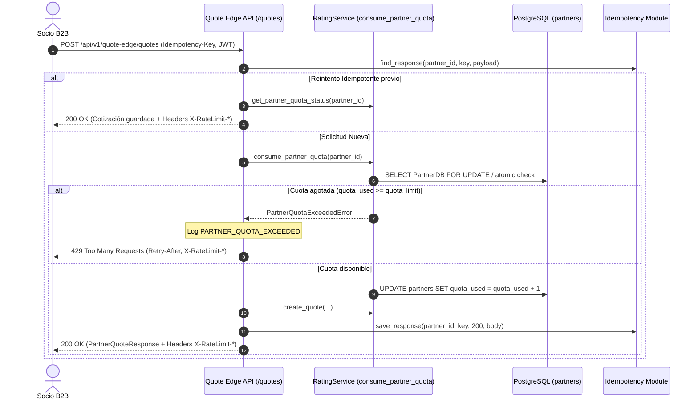

# HU-WEB-12 · Recibir un rechazo claro al superar la cuota contratada

| Field | Value |
|---|---|
| ID | HU-WEB-12 |
| Title | Recibir un rechazo claro al superar la cuota contratada |
| User story | https://github.com/proyectos-miso/proyecto-final-miso/issues/66 |
| Owner | Oscar Saraza |
| Status | DONE |
| Created | 2026-11-07 |
| Security profile | HIGH |

<!-- A spec is a contract: what, why, how, and how we will know it is done. Fill the sections in
     order and stop for agreement between them: Requirements → Design → Tasks.
     Status: DRAFT → READY (after spec-review) → IN_PROGRESS → IN_REVIEW → DONE | BLOCKED. -->

## 1. Requirements

### User story

Como socio de distribución quiero recibir una respuesta explícita cuando supero mi cuota, con el momento a partir del cual puedo reintentar para ajustar el ritmo de mi campaña sin quedarme sin diagnóstico.

| Campo | Valor |
|---|---|
| Tipo | Historia de usuario |
| Componente | Web |
| Feature | FE-WEB-06 |
| Escenario | ESC-ESC-03, ESC-SEG-01 |
| Prioridad | Must have |
| Estimación | 3 puntos |
| Responsable | Oscar Saraza |
| Depende de | HU-WEB-10 |

#### Criterios de aceptación (Gherkin)

1. Rechazo explícito. Dado un socio que agotó la cuota de solicitudes de su plan, cuando envía una cotización más, entonces recibe una respuesta 429 que indica que superó la cuota contratada, sin errores técnicos.
2. Cuándo reintentar. Dado un rechazo por cuota, cuando el socio lee la respuesta, entonces encuentra la cabecera `Retry-After` y la fecha y hora en que la cuota se renueva.
3. Sin afectar a otros socios. Dado un socio que agotó su cuota, cuando otro socio cotiza al mismo tiempo, entonces el otro socio recibe su cotización con normalidad.
4. Cuota restante visible. Dada una solicitud aceptada, cuando el socio recibe la respuesta, entonces ve en cabeceras su límite, lo que le queda y cuándo se renueva.

#### Requisitos no funcionales

- HA-07 · Aislar la carga entre socios con cuotas (#37)
- HA-13 · Atender solo a socios acreditados (#43)
- HA-14 · Confinar cada socio a sus propios datos (#44)

#### Tareas

- [ ] #227 HU-WEB-12.1 · Backend: cuota por socio con ventana de tiempo, compartida entre réplicas.
- [ ] #228 HU-WEB-12.2 · Backend: respuesta 429 con `Retry-After`, fecha de renovación y cabeceras de cuota restante.
- [ ] #229 HU-WEB-12.3 · Documentación del rechazo por cuota en el contrato OpenAPI.
- [ ] #230 HU-WEB-12.4 · Pruebas unitarias, de integración y de aislamiento entre socios.

### Problem and outcome

Los socios de distribución B2B integrados a través de Quote Edge (`POST /api/v1/quote-edge/quotes`) cuentan con un volumen contratado de solicitudes dentro de una ventana de tiempo (ej. 50.000 req/hora o req/mes). Actualmente, el backend incrementa un contador acumulativo plano (`quota_used`) sin verificar si este alcanza o supera `quota_limit`, retornando indefinidamente respuestas HTTP `200 OK`. Cuando un socio agota su cuota o lanza una campaña comercial agresiva, no recibe telemetría sobre su consumo restante ni diagnósticos estandarizados cuando excede su plan, pudiendo saturar la capacidad de cómputo del sistema sin notificación ni aislamiento efectivo.
Resultado: el backend implementa control de cuotas por socio basado en ventanas de tiempo compartidas entre réplicas en PostgreSQL. En toda cotización exitosa (`200 OK`), se devuelven cabeceras RFC 6585 (`X-RateLimit-Limit`, `X-RateLimit-Remaining`, `X-RateLimit-Reset` y `X-RateLimit-Reset-Time`). Cuando el socio supera su cuota, la solicitud se rechaza limpiamente con HTTP `429 Too Many Requests`, cabecera `Retry-After` con los segundos exactos de espera y un cuerpo estructurado con la fecha de renovación. El particionamiento estricto por socio (`partner_id`) garantiza que el agotamiento de cuota de un socio no afecte la operación normal de los demás socios (`HA-07`, `HA-14`).

### Goals and non-goals

Objetivos:
- Implementar la gestión de cuotas de cotización B2B con ventana temporal (`quota_window_seconds`) y fecha de reinicio (`quota_reset_at`) compartida en la tabla `partners`.
- Retornar cabeceras de cuota en respuestas exitosas HTTP 200 OK: `X-RateLimit-Limit`, `X-RateLimit-Remaining`, `X-RateLimit-Reset` y `X-RateLimit-Reset-Time` (CA-04).
- Rechazar solicitudes cuando `quota_used >= quota_limit` dentro de la ventana activa con HTTP 429 Too Many Requests, cabecera `Retry-After` y cuerpo con `reset_at` y `detail` explicativo (CA-01, CA-02).
- Garantizar aislamiento multi-tenant estricto para que un socio bloqueado por cuota no afecte las cotizaciones de ningún otro socio (CA-03, HA-07).
- Mantener compatibilidad con la idempotencia de HU-WEB-11: un reintento con la misma `Idempotency-Key` (<24h) retorna la cotización previa sin descontar cuota adicional ni fallar con 429.
- Documentar el código 429, el modelo de respuesta `PartnerQuotaExceededResponse` y las cabeceras en el contrato OpenAPI.
- Auditar los rechazos por cuota excedida con el código de evento de seguridad `PARTNER_QUOTA_EXCEEDED` en CloudWatch.

Fuera de alcance:
- Control de cuotas o limitación de tasa en el portal web interno de asesores comerciales (aplica exclusivamente al canal de socios B2B Quote Edge).
- Mecanismos de pago o cobro automático de sobrecostos por exceso de cuota.
- Servidor de caché en memoria Redis (se emplea la persistencia transaccional ACID existente en PostgreSQL).

### Affected paths

| Path | Change |
|---|---|
| backend/app/core/config.py | Configuración de ventana de cuota por defecto (`PARTNER_QUOTA_WINDOW_SECONDS`) |
| backend/app/modules/rating/models.py | Nuevos campos `quota_window_seconds` y `quota_reset_at` en `PartnerDB`, y modelo `PartnerQuotaExceededResponse` |
| backend/app/modules/rating/service.py | Excepción `PartnerQuotaExceededError`, funciones `consume_partner_quota` y `get_partner_quota_status` |
| backend/app/bff/quote_edge/router.py | Validación de cuota, inyección de cabeceras `X-RateLimit-*`, respuesta HTTP 429 con `Retry-After`, auditoría y OpenAPI |
| backend/app/main.py | Migración idempotente de columnas de cuota en `lifespan` y exposición de cabeceras en CORS |
| backend/tests/conftest.py | Actualización de `InMemorySessionTestDouble` para simular ventanas y cuotas |
| backend/tests/unit/test_partner_quota.py | Pruebas unitarias de consumo, expiración de ventana y cálculo de Retry-After |
| backend/tests/integration/test_partner_quote_api.py | Pruebas de integración de rechazo 429, cabeceras, aislamiento concurrente y OpenAPI |
| backend/README.md | Documentación de telemetría de cuotas y rechazo 429 |
| CHANGELOG.md | Registro de cambios bajo el estándar Keep a Changelog |

### Use cases

| ID | Actor | Use case | Main flow | Alternate flows |
|---|---|---|---|---|
| UC-01 | Socio B2B | Cotización exitosa con telemetría de cuota | 1. Envía `POST /api/v1/quote-edge/quotes` con token Bearer válido, encabezado `Idempotency-Key` y payload válido. 2. Backend verifica que el socio tiene cuota disponible (`quota_used < quota_limit`). 3. Incrementa `quota_used`, calcula cotización y persiste. 4. Retorna HTTP 200 OK con la cotización y las cabeceras `X-RateLimit-Limit`, `X-RateLimit-Remaining`, `X-RateLimit-Reset` y `X-RateLimit-Reset-Time`. | Si la ventana venció, la renueva automáticamente a partir del timestamp actual antes de procesar. |
| UC-02 | Socio B2B | Rechazo explícito por cuota contratada superada | 1. Envía `POST /api/v1/quote-edge/quotes` habiendo consumido la totalidad de su cuota contratada (`quota_used >= quota_limit`). 2. Backend detecta cuota agotada dentro de la ventana activa. 3. Registra evento de auditoría `PARTNER_QUOTA_EXCEEDED`. 4. Retorna HTTP 429 Too Many Requests con cabecera `Retry-After` (segundos restantes) y cuerpo con `reset_at` y mensaje explicativo. | Si envía una `Idempotency-Key` procesada exitosamente con anterioridad, retorna la cotización previa con HTTP 200 OK sin descontar cuota ni bloquear. |
| UC-03 | Dos Socios B2B | Cotización simultánea con aislamiento multi-tenant | 1. Socio A (con cuota agotada) envía cotización a Quote Edge. 2. Socio B (con cuota disponible) envía cotización simultáneamente. 3. Backend rechaza la solicitud del Socio A con HTTP 429. 4. Backend atiende la solicitud del Socio B con HTTP 200 OK y su propia cuota independiente. | Cada socio opera en su propio particionamiento sin interferencias. |
| UC-04 | Socio B2B | Renovación automática de cuota al expirar la ventana | 1. Socio agotó su cuota y transcurre el tiempo hasta superar `quota_reset_at`. 2. Envía una nueva cotización. 3. Backend detecta vencimiento de ventana, reinicia `quota_used` a 0 y establece nueva fecha de fin. 4. Atiende la cotización con HTTP 200 OK. | Si el token expiró durante la espera, retorna 401 Unauthorized. |

### Abuse cases

| ID | Abuse case | Actor | Threat | Expected response | Test case |
|---|---|---|---|---|---|
| AB-01 | Enviar ráfagas masivas de cotizaciones tras agotar cuota para intentar forzar el cálculo o degradar el servicio | Socio hostil o cliente mal programado | THR-01 | HTTP 429 Too Many Requests inmediato en el borde sin tocar el motor de tarificación ni buró | TC-02 |
| AB-02 | Intentar manipular o falsear cabeceras de cliente para evadir el bloqueo de cuota de su socio | Socio hostil | THR-02 | Cuota evaluada estrictamente contra el `partner_id` derivado del token JWT firmado en el servidor | TC-03 |
| AB-03 | Inducir denegación de servicio a otro socio consumiendo cuota masiva | Socio abusivo | THR-03 | Aislamiento multi-tenant: la cuota está particionada por socio; agotar Socio A no afecta a Socio B | TC-03 |
| AB-04 | Reenviar solicitudes repetidas para forzar errores 500 o filtrar trazas internas de la base de datos | Atacante | THR-04 | Respuesta HTTP 429 limpia con formato estándar RFC 6585 y RFC 7807 sin stack traces ni datos internos | TC-02 |

### Acceptance criteria

| ID | Criterion | Source |
|---|---|---|
| AC-01 | WHEN un socio que ha agotado la cuota de su plan envía una nueva cotización POST /api/v1/quote-edge/quotes, THE backend SHALL retornar una respuesta HTTP 429 Too Many Requests con mensaje claro sin errores técnicos | STATED |
| AC-02 | WHEN el backend responde con código HTTP 429 por cuota superada, THE backend SHALL incluir la cabecera Retry-After con el tiempo restante en segundos y la fecha y hora exacta en que se renueva la cuota | STATED |
| AC-03 | WHEN un socio con cuota agotada cotiza simultáneamente con otro socio activo, THE backend SHALL procesar la cotización del segundo socio con normalidad retornando HTTP 200 OK | STATED |
| AC-04 | WHEN una cotización es aceptada y procesada exitosamente con HTTP 200 OK, THE backend SHALL incluir en las cabeceras HTTP X-RateLimit-Limit, X-RateLimit-Remaining y el instante de reinicio X-RateLimit-Reset | STATED |
| AC-05 | WHEN un socio con cuota agotada reenvía una Idempotency-Key previamente procesada dentro de las 24 horas, THE backend SHALL retornar la cotización previa con HTTP 200 OK sin descontar cuota ni rechazar con 429 | DERIVED: compatibilidad con HU-WEB-11 e idempotencia |
| AC-06 | WHEN la fecha actual supera el momento de renovación quota_reset_at de un socio, THE backend SHALL reiniciar automáticamente quota_used y atender las solicitudes con una nueva ventana | DERIVED: gestión temporal de cuotas HA-07 |

### Quality requirements

| ID | Category | Requirement | Target and conditions |
|---|---|---|---|
| QR-01 | PERFORMANCE | Rechazo inmediato en la capa de borde ante cuotas agotadas sin invocar buró de crédito ni ejecutar fórmulas de tarificación | Latencia p95 ≤ 25 ms en respuestas HTTP 429 |
| QR-02 | MAINTAINABILITY | Persistencia transaccional de cuotas en PostgreSQL garantizando sincronización atómica entre réplicas del backend sin drift | 100% de pruebas unitarias y de integración pasando exitosamente |

### Security triggers

| Trigger | Applies | Rationale |
|---|---|---|
| Personal data (identifies or can identify a person) | YES | Las solicitudes de cotización contienen tipo y número de documento del cliente asegurado |
| Sensitive data (special categories, biometrics, health, financial, minors) | NO | No se procesan datos biométricos, médicos ni de menores de edad |
| Authentication, sessions, credentials or one-time codes | YES | Requiere autenticación de socios B2B mediante OAuth2 JWT en Quote Edge |
| Authorization or access to other users' resources | YES | Control de acceso y aislamiento estricto de cuotas y datos por socio |
| Payments or money movement | NO | El endpoint es de cotización de seguros; el cobro de primas se efectúa en otro módulo |
| Third-party services or integrations | YES | El motor de rating consulta la simulación de buró crediticio externo si hay cuota disponible |
| Infrastructure, network, IAM, CI/CD or secrets | NO | No se crean recursos de infraestructura ni secretos nuevos en AWS |
| Multiple tenants, partners or organizations | YES | Múltiples socios B2B comparten la API con asignaciones de cuota independientes |
| Storage or processing on a mobile device | NO | Servicio backend B2B M2M |
| Web UI or data exposed in the browser | NO | Endpoint REST API sin interfaz web directa |
| New or updated dependencies | NO | No se añaden nuevas dependencias externas en Poetry |
| Critical paths (sdd/security/critical-paths.md) | YES | Modifica `backend/app/bff/quote_edge/router.py` y `backend/app/modules/rating/service.py` |

### Security requirements

| ID | Requirement | Source | Controls | Priority |
|---|---|---|---|---|
| SR-01 | Controlar el consumo de solicitudes en Quote Edge mediante cuotas particionadas estrictamente por socio impidiendo que un socio monopolice o sature el servicio | THR-01 | CTL-01 | HIGH |
| SR-02 | Responder con HTTP 429 y cabecera estándar Retry-After con formato de error genérico sin exponer detalles internos de base de datos ni stack traces | THR-04 | CTL-02 | HIGH |
| SR-03 | Garantizar el aislamiento de cuotas y datos de cotización en base de datos PostgreSQL compartida entre réplicas impidiendo colisiones o afectaciones cruzadas entre socios | DATA-01, THR-03 | CTL-03 | HIGH |
| SR-04 | Registrar eventos de seguridad estructurados PARTNER_QUOTA_EXCEEDED en CloudWatch ante intentos de cotización con cuota superada | THR-01 | CTL-04 | MEDIUM |

## 2. Design

### Components

- `backend/app/core/config.py`: define `PARTNER_QUOTA_WINDOW_SECONDS: int = 3600` (ventana de 1 hora configurable).
- `backend/app/modules/rating/models.py`:
  - En `PartnerDB` se agregan las columnas `quota_window_seconds` (Integer, default 3600) y `quota_reset_at` (DateTime con timezone).
  - Nuevo modelo Pydantic `PartnerQuotaExceededResponse` con campos `detail`, `error`, `retry_after`, `reset_at`, `quota_limit` y `quota_remaining`.
  - Nueva clase `PartnerQuotaStatus` con los metadatos de cuota calculados en memoria para inyección de cabeceras.
- `backend/app/modules/rating/service.py`:
  - Nueva excepción `PartnerQuotaExceededError`.
  - Método `consume_partner_quota`: evalúa si la ventana expiró (reiniciándola), valida disponibilidad o lanza `PartnerQuotaExceededError`, e incrementa atómicamente `quota_used`.
  - Método `get_partner_quota_status`: consulta el estado actual de la ventana sin incrementar el contador (para reintentos idempotentes).
- `backend/app/bff/quote_edge/router.py`:
  - Helper `_quota_headers` para generar las cabeceras `X-RateLimit-*`.
  - Intercepción previa en `POST /quotes`: invoca `consume_partner_quota`. Si lanza `PartnerQuotaExceededError`, loguea auditoría y responde 429 con `Retry-After`.
  - Inyección de cabeceras `X-RateLimit-*` en toda respuesta HTTP 200 OK.
  - Documentación de 429 y cabeceras en el decorador FastAPI.
- `backend/app/main.py`:
  - Migración idempotente en `lifespan` agregando columnas a `partners` si no existen.
  - Exposición de cabeceras de cuota en `CORSMiddleware`.

### Data flows



### Data contract

- **Endpoint**: `POST /api/v1/quote-edge/quotes`
- **Encabezados de solicitud**:
  - `Authorization: Bearer <jwt_partner_token>` (Obligatorio)
  - `Idempotency-Key: <string>` (Obligatorio)
- **Cabeceras de respuesta HTTP 200 OK**:
  - `X-RateLimit-Limit`: entero en formato string (límite contratado, ej. `50000`).
  - `X-RateLimit-Remaining`: entero en formato string (solicitudes disponibles en la ventana, ej. `49999`).
  - `X-RateLimit-Reset`: epoch timestamp UNIX en segundos de la renovación (ej. `1761922800`).
  - `X-RateLimit-Reset-Time`: fecha y hora UTC ISO-8601 de renovación (ej. `2026-10-31T15:00:00+00:00`).
- **Cabeceras de respuesta HTTP 429 Too Many Requests**:
  - `Retry-After`: segundos enteros que el socio debe esperar antes de reintentar (ej. `1500`).
  - `X-RateLimit-Limit`: límite contratado.
  - `X-RateLimit-Remaining`: `0`.
  - `X-RateLimit-Reset`: epoch timestamp UNIX.
  - `X-RateLimit-Reset-Time`: fecha y hora UTC ISO-8601.
- **Cuerpo de respuesta HTTP 429 (JSON `PartnerQuotaExceededResponse`)**:
  ```json
  {
    "detail": "Se ha superado la cuota de solicitudes contratada para el socio.",
    "error": "QUOTA_EXCEEDED",
    "retry_after": 1500,
    "reset_at": "2026-10-31T15:00:00+00:00",
    "quota_limit": 50000,
    "quota_remaining": 0
  }
  ```

### Security design decisions

| Decision | Implements | Rejected alternative and why |
|---|---|---|
| Persistencia relacional de cuota en PostgreSQL con reinicio automático por ventana | CTL-01, CTL-03, SR-01, SR-03 | Servidor Redis externo: rechazada para no introducir dependencias operacionales adicionales y mantener atomicidad transaccional |
| Cabeceras estandarizadas RFC 6585 (`Retry-After`, `X-RateLimit-*`) | CTL-02, SR-02 | Mensajes de texto plano o códigos de error propietarios: rechazada porque los socios B2B requieren integración estándar y automatizada |
| Exclusión del consumo de cuota en reintentos idempotentes exitosos | CTL-01, AC-05 | Penalizar cada reintento de red: rechazada porque penalizaría caídas de conexión sin que el socio reciba valor nuevo |
| Auditoría estructurada sin datos personales en rechazos 429 | CTL-04, SR-04 | Imprimir cuerpo de solicitud en logs: rechazada por violar principios de privacidad de datos personales en logs |

### Architecture decisions

N/A: implementa los estándares definidos en ADR 0001 (Separated Applications), ADR 0002 (API Contract), ADR 0003 (Backend Hexagonal Architecture) y ADR 0007 (Backend Errors and Responses).

### Configuration and deployment

- Variable `PARTNER_QUOTA_WINDOW_SECONDS` en configuración con valor por defecto de 3600 segundos (1 hora).
- Migración idempotente automática en `lifespan` de FastAPI sin requerir downtime ni scripts manuales de base de datos.

## 3. Tasks

| ID | Task | Traces to | Controls | Status | Evidence |
|---|---|---|---|---|---|
| T-01 | #227 HU-WEB-12.1 · Backend: cuota por socio con ventana de tiempo, compartida entre réplicas | AC-01, AC-03, AC-04, AC-06, SR-01, SR-03 | CTL-01, CTL-03 | DONE | backend/app/modules/rating/service.py |
| T-02 | #228 HU-WEB-12.2 · Backend: respuesta 429 con Retry-After, fecha de renovación y cabeceras de cuota restante | AC-01, AC-02, AC-04, AC-05, SR-02, SR-04 | CTL-02, CTL-04 | DONE | backend/app/bff/quote_edge/router.py |
| T-03 | #229 HU-WEB-12.3 · Documentación del rechazo por cuota en el contrato OpenAPI | AC-01, AC-02, SR-02 | CTL-02 | DONE | backend/app/bff/quote_edge/router.py |
| T-04 | #230 HU-WEB-12.4 · Pruebas unitarias, de integración y de aislamiento entre socios | AC-01, AC-02, AC-03, AC-04, AC-05, AC-06, QR-01, QR-02, SR-01, SR-02, SR-03, SR-04 | CTL-01, CTL-02, CTL-03, CTL-04 | DONE | backend/tests/integration/test_partner_quote_api.py |
| T-05 | Documentación y registro en CHANGELOG.md bajo estándar Keep a Changelog | AC-01, AC-04 | — | DONE | CHANGELOG.md |
