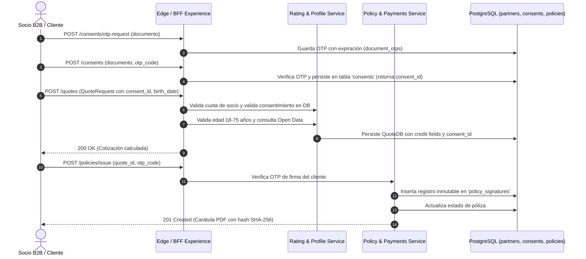

# HU-WEB-12 · Recibir un rechazo claro al superar la cuota contratada

| Field | Value |
|---|---|
| ID | HU-WEB-12 |
| Title | Recibir un rechazo claro al superar la cuota contratada |
| User story | https://github.com/proyectos-miso/proyecto-final-miso/issues/66 |
| Owner | Oscar Saraza |
| Status | DONE |
| Created | 2026-11-07 |
| Security profile | HIGH |

<!-- A spec is a contract: what, why, how, and how we will know it is done. Fill the sections in
     order and stop for agreement between them: Requirements → Design → Tasks.
     Status: DRAFT → READY (after spec-review) → IN_PROGRESS → IN_REVIEW → DONE | BLOCKED. -->

## 1. Requirements

### User story

Como socio de distribución quiero recibir una respuesta explícita cuando supero mi cuota, con el momento a partir del cual puedo reintentar para ajustar el ritmo de mi campaña sin quedarme sin diagnóstico.

| Campo | Valor |
|---|---|
| Tipo | Historia de usuario |
| Componente | Web y Backend |
| Feature | FE-WEB-02, FE-WEB-05, FE-WEB-06 |
| Escenario | ESC-ESC-03, ESC-SEG-01 |
| Prioridad | Must have |
| Estimación | 3 puntos |
| Responsable | Oscar Saraza |
| Depende de | HU-WEB-10 |

#### Criterios de aceptación (Gherkin)

1. Rechazo explícito. Dado un socio que agotó la cuota de solicitudes de su plan, cuando envía una cotización más, entonces recibe una respuesta 429 que indica que superó la cuota contratada, sin errores técnicos.
2. Cuándo reintentar. Dado un rechazo por cuota, cuando el socio lee la respuesta, entonces encuentra la cabecera `Retry-After` y la fecha y hora en que la cuota se renueva.
3. Sin afectar a otros socios. Dado un socio que agotó su cuota, cuando otro socio cotiza al mismo tiempo, entonces el otro socio recibe su cotización con normalidad.
4. Cuota restante visible. Dada una solicitud aceptada, cuando el socio recibe la respuesta, entonces ve en cabeceras su límite, lo que le queda y cuándo se renueva.

#### Requisitos no funcionales

- HA-07 · Aislar la carga entre socios con cuotas (#37)
- HA-13 · Atender solo a socios acreditados (#43)
- HA-14 · Confinar cada socio a sus propios datos (#44)
- HA-23 · Registro y autoservicio de socios con entornos
- HA-24 · Integración de Open Data y Open Finance en perfilamiento

#### Tareas

- [x] #227 HU-WEB-12.1 · Backend: cuota por socio con ventana de tiempo, compartida entre réplicas.
- [x] #228 HU-WEB-12.2 · Backend: respuesta 429 con `Retry-After`, fecha de renovación y cabeceras de cuota restante.
- [x] #229 HU-WEB-12.3 · Documentación del rechazo por cuota en el contrato OpenAPI.
- [x] #230 HU-WEB-12.4 · Pruebas unitarias, de integración y de aislamiento entre socios.
- [ ] Brechas funcionales asociadas (RC-02, RC-03, RC-04, RC-06, RC-07, RC-08, RC-09, RC-10, RC-23, RC-24, RC-25).

### Problem and outcome

Los socios de distribución B2B integrados a través de Quote Edge (`POST /api/v1/quote-edge/quotes`) cuentan con un volumen contratado de solicitudes dentro de una ventana de tiempo (ej. 50.000 req/hora o req/mes). Originalmente, el backend incrementaba un contador acumulativo plano (`quota_used`) sin verificar si este alcanza o supera `quota_limit`, retornando indefinidamente respuestas HTTP `200 OK`. Cuando un socio agota su cuota o lanza una campaña comercial agresiva, no recibe telemetría sobre su consumo restante ni diagnósticos estandarizados cuando excede su plan, pudiendo saturar la capacidad de cómputo del sistema sin notificación ni aislamiento efectivo.
Adicionalmente, el flujo completo de emisión, cotización y pagos asociado a la historia presenta 11 brechas funcionales críticas identificadas en el seguimiento:
1. La póliza se emite sin requerir la firma del cliente mediante código de un solo uso (OTP) ni registro de constancia inmutable (RC-02).
2. Los errores de pago y emisión muestran un mensaje genérico de reintento en el portal, incluso en fallos definitivos como 404, 409 o 422 (RC-03).
3. El cotizador y la pantalla de pago incluyen datos de prueba quemados en producción (RC-04).
4. El consentimiento informado no es obligatorio para cotizar, vive en memoria volátil y acepta cualquier código sin validación real (RC-06).
5. El campo `birth_date` se procesa como texto plano y no se valida el rango de edad asegurable (18 a 75 años) en el motor de tarificación (RC-07).
6. Los campos de crédito `financial_entity` y `term_months` se capturan en la interfaz pero se descartan antes de persistir la cotización (RC-08).
7. La API expone públicamente un parámetro de depuración `simulated_delay` que puede ser explotado para inducir degradación de rendimiento (RC-09).
8. Los cobros de prima en el backend se registran con un socio fijo `partner_id="default"` en lugar de heredar el socio del token o la póliza (RC-10).
9. Los socios de distribución no disponen de un flujo de autoservicio para registrarse en sandbox con cuota inicial y pasar a producción tras aprobación (RC-23).
10. Las pólizas no expiran al finalizar su vigencia ni soportan el ciclo de renovación (RC-24).
11. El perfilamiento de asegurabilidad depende de un simulador estático sin consultar fuentes de Open Data reales con tolerancia a fallos (RC-25).

Resultado: el backend implementa control de cuotas por socio basado en ventanas de tiempo compartidas entre réplicas en PostgreSQL. En toda cotización exitosa (`200 OK`), se devuelven cabeceras RFC 6585 (`X-RateLimit-Limit`, `X-RateLimit-Remaining`, `X-RateLimit-Reset` y `X-RateLimit-Reset-Time`). Cuando el socio supera su cuota, la solicitud se rechaza limpiamente con HTTP `429 Too Many Requests`, cabecera `Retry-After` con los segundos exactos de espera y un cuerpo estructurado con la fecha de renovación. El particionamiento estricto por socio (`partner_id`) garantiza que el agotamiento de cuota de un socio no afecte la operación normal de los demás socios (`HA-07`, `HA-14`).
Asimismo, se subsanan integralmente las 11 brechas: se exige consentimiento previo en PostgreSQL validado con OTP; se valida estrictamente `birth_date: date` entre 18 y 75 años; se persisten los campos de crédito; se remueve `simulated_delay`; se firma la póliza con OTP almacenando constancia inmutable y hash SHA-256 en la carátula PDF; se corrigen los códigos de error en pagos y se eliminan datos de prueba; se asegura la atribución de `partner_id` en pagos; se habilita autoservicio en sandbox para socios; se introduce el ciclo de vida `EXPIRED` con mantenimiento diario y renovación; y se integra un adaptador a Open Data real con degradación suave.

### Goals and non-goals

Objetivos:
- Implementar la gestión de cuotas de cotización B2B con ventana temporal (`quota_window_seconds`) y fecha de reinicio (`quota_reset_at`) compartida en la tabla `partners`.
- Retornar cabeceras de cuota en respuestas exitosas HTTP 200 OK: `X-RateLimit-Limit`, `X-RateLimit-Remaining`, `X-RateLimit-Reset` y `X-RateLimit-Reset-Time` (CA-04).
- Rechazar solicitudes cuando `quota_used >= quota_limit` dentro de la ventana activa con HTTP 429 Too Many Requests, cabecera `Retry-After` y cuerpo con `reset_at` y `detail` explicativo (CA-01, CA-02).
- Garantizar aislamiento multi-tenant estricto para que un socio bloqueado por cuota no afecte las cotizaciones de ningún otro socio (CA-03, HA-07).
- Mantener compatibilidad con la idempotencia de HU-WEB-11: un reintento con la misma `Idempotency-Key` (<24h) retorna la cotización previa sin descontar cuota adicional ni fallar con 429.
- Exigir consentimiento informado previo persistido en PostgreSQL verificado con OTP real antes de crear cotizaciones (RC-06).
- Validar `birth_date` como fecha válida restringiendo la edad asegurable entre 18 y 75 años en `create_quote` retornando HTTP 422 ante incumplimiento (RC-07).
- Persistir la entidad financiera y plazo del crédito en la tabla `quotes` (RC-08).
- Eliminar el parámetro `simulated_delay` de los contratos públicos de cotización (RC-09).
- Exigir código de un solo uso (OTP) para la aceptación/emisión de pólizas, registrando constancia inmutable en `policy_signatures` y estampando el hash SHA-256 del PDF en la carátula (RC-02).
- Manejar respuestas de error de cobro de forma granular (402, 404, 409, 422, 502) en el portal de cotizador sin permitir reintento en fallos definitivos (RC-03).
- Eliminar valores quemados de prueba (cédulas y tarjetas sin fondos) de los componentes en producción (RC-04).
- Asociar los cobros al `partner_id` autenticado en los claims del token en lugar de `"default"` (RC-10).
- Habilitar el registro de socios por autoservicio en sandbox con cuota inicial y flujo de aprobación para promoción a producción (RC-23).
- Implementar el estado `EXPIRED`, rutina periódica de vencimiento de pólizas y acción de renovación (RC-24).
- Conectar el perfilamiento a una fuente real de Open Data (`datos.gov.co`) y simulación Open Finance detrás de una interfaz común con degradación ante indisponibilidad (RC-25).

Fuera de alcance:
- Cobro automático de sobrecostos por exceso de cuota comercial.
- Servidor de caché en memoria Redis (se emplea la persistencia transaccional ACID existente en PostgreSQL).
- Pasarelas de pago físicas o adquirencia de terminales punto de venta.

### Affected paths

| Path | Change |
|---|---|
| backend/app/core/config.py | Configuración de ventana de cuota por defecto (`PARTNER_QUOTA_WINDOW_SECONDS`) |
| backend/app/modules/profile/models.py | Definición del modelo `ConsentDB` en tabla relacional `consents` |
| backend/app/modules/profile/service.py | Persistencia y verificación de consentimientos en PostgreSQL |
| backend/app/modules/rating/models.py | Columnas de cuota, campos `financial_entity`, `term_months` y `consent_id` en cotización, y entorno en `PartnerDB` |
| backend/app/modules/rating/service.py | Cuotas por socio, validación de edad (18-75), adaptación de Open Data real y verificación de consentimiento |
| backend/app/modules/policy/models.py | Estado `EXPIRED` en `PolicyStatus`, y tabla inmutable `policy_signatures` |
| backend/app/modules/policy/service.py | Firma de póliza con OTP, rutina de expiración de pólizas y mantenimiento diario |
| backend/app/modules/policy/operations.py | Registro de eventos `EXPIRED` y `RENEWED` en `POLICY_EVENTS` y función de renovación |
| backend/app/modules/policy/document.py | Inclusión de constancia de firma, consentimiento y hash SHA-256 en la carátula PDF |
| backend/app/modules/auth/service.py | Idempotencia en siembra y autenticación de usuarios |
| backend/app/modules/identity/db_models.py | Persistencia de códigos OTP y modelo de verificación |
| backend/app/modules/identity/service.py | Generación y validación de OTP para consentimientos y firma |
| backend/app/modules/payments/models.py | Asociación de `partner_id` al registro de cobro |
| backend/app/modules/payments/service.py | Captura del socio autenticado para el cobro de primas |
| backend/app/bff/experience/router.py | Eliminación de `simulated_delay`, endpoints de OTP para consentimientos y pase de socio en cobro |
| backend/app/bff/experience/operations_router.py | Endpoints de aprobación de socios a producción y renovación de pólizas |
| backend/app/bff/quote_edge/router.py | Eliminación de `simulated_delay`, endpoints de registro de socios en sandbox y cuotas B2B |
| backend/app/main.py | Migraciones idempotentes en `lifespan` (`consents`, `policy_signatures`, columnas en `partners` y `quotes`) |
| web/src/app/core/models/quote.model.ts | Campos `consent_id`, `financial_entity`, `term_months` y tipo `date` |
| web/src/app/features/cotizador/consent-step/consent-step.component.ts | Solicitud y validación de OTP para consentimiento y limpieza de cédula quemada |
| web/src/app/features/cotizador/cotizador.component.ts | Firma de póliza con OTP, propagación de campos de crédito y consentimiento |
| web/src/app/features/cotizador/payment-step/payment-step.component.ts | Mensajes diferenciados según código HTTP y eliminación de medios de prueba |
| web/src/app/features/gestion/gestion.component.ts | Visualización de pólizas `EXPIRED` y botón de renovación |
| backend/tests/unit/test_partner_quota.py | Pruebas unitarias de consumo, expiración de ventana y cálculo de Retry-After |
| backend/tests/integration/test_partner_quote_api.py | Pruebas de integración de rechazo 429, cabeceras, aislamiento concurrente y OpenAPI |
| backend/README.md | Documentación de telemetría de cuotas, brechas subsanadas y APIs |
| CHANGELOG.md | Registro de cambios bajo el estándar Keep a Changelog |

### Use cases

| ID | Actor | Use case | Main flow | Alternate flows |
|---|---|---|---|---|
| UC-01 | Socio B2B | Cotización exitosa con telemetría de cuota | 1. Envía `POST /api/v1/quote-edge/quotes` con token Bearer válido, encabezado `Idempotency-Key` y payload válido. 2. Backend verifica que el socio tiene cuota disponible (`quota_used < quota_limit`). 3. Incrementa `quota_used`, calcula cotización y persiste. 4. Retorna HTTP 200 OK con la cotización y las cabeceras `X-RateLimit-Limit`, `X-RateLimit-Remaining`, `X-RateLimit-Reset` y `X-RateLimit-Reset-Time`. | Si la ventana venció, la renueva automáticamente a partir del timestamp actual antes de procesar. |
| UC-02 | Socio B2B | Rechazo explícito por cuota contratada superada | 1. Envía `POST /api/v1/quote-edge/quotes` habiendo consumido la totalidad de su cuota contratada (`quota_used >= quota_limit`). 2. Backend detecta cuota agotada dentro de la ventana activa. 3. Registra evento de auditoría `PARTNER_QUOTA_EXCEEDED`. 4. Retorna HTTP 429 Too Many Requests con cabecera `Retry-After` (segundos restantes) y cuerpo con `reset_at` y mensaje explicativo. | Si envía una `Idempotency-Key` procesada exitosamente con anterioridad, retorna la cotización previa con HTTP 200 OK sin descontar cuota ni bloquear. |
| UC-03 | Dos Socios B2B | Cotización simultánea con aislamiento multi-tenant | 1. Socio A (con cuota agotada) envía cotización a Quote Edge. 2. Socio B (con cuota disponible) envía cotización simultáneamente. 3. Backend rechaza la solicitud del Socio A con HTTP 429. 4. Backend atiende la solicitud del Socio B con HTTP 200 OK y su propia cuota independiente. | Cada socio opera en su propio particionamiento sin interferencias. |
| UC-04 | Socio B2B | Renovación automática de cuota al expirar la ventana | 1. Socio agotó su cuota y transcurre el tiempo hasta superar `quota_reset_at`. 2. Envía una nueva cotización. 3. Backend detecta vencimiento de ventana, reinicia `quota_used` a 0 y establece nueva fecha de fin. 4. Atiende la cotización con HTTP 200 OK. | Si el token expiró durante la espera, retorna 401 Unauthorized. |
| UC-05 | Cliente / Asesor | Captura de consentimiento con validación OTP | 1. Ingresa datos del titular en el cotizador. 2. Solicita envío de OTP de consentimiento. 3. Cliente ingresa código de 6 dígitos. 4. Backend valida OTP, crea registro persistente en `consents` y retorna `consent_id`. | Si el OTP es incorrecto o expiró, se rechaza y no se emite el consentimiento. |
| UC-06 | Cliente / Asesor | Firma de póliza con código OTP y generación de carátula inmutable | 1. Cliente revisa cotización y decide aceptarla. 2. Ingresa código OTP de firma. 3. Backend valida OTP, verifica consentimiento previo, registra firma inmutable en `policy_signatures` y genera carátula PDF con hash SHA-256. | Si el código OTP es inválido, la emisión se detiene con error de autorización. |
| UC-07 | Asesor Comercial | Gestión y diagnóstico de errores en pago | 1. Asesor procesa cobro con medio de pago. 2. Backend retorna código HTTP específico (402, 404, 409, 422, 502). 3. Frontend presenta mensaje descriptivo según el error e inhabilita reintentos en fallos definitivos. | En fallos de comunicación temporales (502), se ofrece reintento guiado. |
| UC-08 | Socio B2B | Autoservicio y registro de socio en sandbox | 1. Socio envía formulario de registro en `POST /partners/register`. 2. Backend crea socio con `environment='sandbox'`, credenciales iniciales y cuota acotada. 3. Socio prueba contra Quote Edge. | Analista de operaciones evalúa al socio y ejecuta aprobación formal para su paso a producción. |
| UC-09 | Analista de Operaciones | Expiración y renovación de pólizas vencidas | 1. Tarea programada diaria identifica pólizas con vigencia vencida y las marca `EXPIRED`. 2. Analista visualiza pólizas vencidas en portal de operaciones y ejecuta renovación. 3. Se genera nuevo periodo de vigencia. | Si la póliza ya está cancelada o renovada, no se permite doble renovación. |
| UC-10 | Motor de Tarificación | Perfilamiento con Open Data real y tolerancia a fallos | 1. Cotización invoca adaptador Open Data (`datos.gov.co`). 2. Si la consulta responde dentro del límite de 400 ms, se incorpora al cálculo de riesgo. 3. Si falla o timeout, degrada graciosamente al score base. | Fallo en la fuente externa no interrumpe la emisión de la cotización. |

### Abuse cases

| ID | Abuse case | Actor | Threat | Expected response | Test case |
|---|---|---|---|---|---|
| AB-01 | Enviar ráfagas masivas de cotizaciones tras agotar cuota para intentar forzar el cálculo o degradar el servicio | Socio hostil o cliente mal programado | THR-01 | HTTP 429 Too Many Requests inmediato en el borde sin tocar el motor de tarificación ni buró | TC-02 |
| AB-02 | Intentar manipular o falsear cabeceras de cliente para evadir el bloqueo de cuota de su socio | Socio hostil | THR-02 | Cuota evaluada estrictamente contra el `partner_id` derivado del token JWT firmado en el servidor | TC-03 |
| AB-03 | Inducir denegación de servicio a otro socio consumiendo cuota masiva | Socio abusivo | THR-03 | Aislamiento multi-tenant: la cuota está particionada por socio; agotar Socio A no afecta a Socio B | TC-03 |
| AB-04 | Reenviar solicitudes repetidas para forzar errores 500 o filtrar trazas internas de la base de datos | Atacante | THR-04 | Respuesta HTTP 429 limpia con formato estándar RFC 6585 y RFC 7807 sin stack traces ni datos internos | TC-02 |
| AB-05 | Intentar cotizar sin consentimiento previo del cliente o con `consent_id` inexistente o alterado | Asesor deshonesto / Atacante | THR-05 | Rechazo HTTP 422 por falta de consentimiento válido persistido en base de datos | TC-08 |
| AB-06 | Intentar modificar o eliminar una firma de póliza emitida para alterar la evidencia legal | Usuario malicioso / Actor interno | THR-06 | Bloqueo a nivel de PostgreSQL mediante disparador de inmutabilidad (`make_immutable`) | TC-09 |
| AB-07 | Enviar `simulated_delay` en solicitud de cotización para forzar retardo en backend | Atacante | THR-08 | El parámetro no es reconocido por el contrato y no introduce retrasos en la API | TC-11 |
| AB-08 | Intentar enviar cobros adjudicados a un partner ajeno manipulando parámetros de cliente | Atacante | THR-09 | `partner_id` tomado exclusivamente de los claims del token JWT validado en servidor | TC-12 |

### Acceptance criteria

| ID | Criterion | Source |
|---|---|---|
| AC-01 | WHEN un socio que ha agotado la cuota de su plan envía una nueva cotización POST /api/v1/quote-edge/quotes, THE backend SHALL retornar una respuesta HTTP 429 Too Many Requests con mensaje claro sin errores técnicos | STATED |
| AC-02 | WHEN el backend responde con código HTTP 429 por cuota superada, THE backend SHALL incluir la cabecera Retry-After con el tiempo restante en segundos y la fecha y hora exacta en que se renueva la cuota | STATED |
| AC-03 | WHEN un socio con cuota agotada cotiza simultáneamente con otro socio activo, THE backend SHALL procesar la cotización del segundo socio con normalidad retornando HTTP 200 OK | STATED |
| AC-04 | WHEN una cotización es aceptada y procesada exitosamente con HTTP 200 OK, THE backend SHALL incluir en las cabeceras HTTP X-RateLimit-Limit, X-RateLimit-Remaining y el instante de reinicio X-RateLimit-Reset | STATED |
| AC-05 | WHEN un socio con cuota agotada reenvía una Idempotency-Key previamente procesada dentro de las 24 horas, THE backend SHALL retornar la cotización previa con HTTP 200 OK sin descontar cuota ni rechazar con 429 | DERIVED: compatibilidad con HU-WEB-11 e idempotencia |
| AC-06 | WHEN la fecha actual supera el momento de renovación quota_reset_at de un socio, THE backend SHALL reiniciar automáticamente quota_used y atender las solicitudes con una nueva ventana | DERIVED: gestión temporal de cuotas HA-07 |
| AC-07 | WHEN el cliente acepta la cotización, THE sistema SHALL exigir su código de un solo uso y guardar una constancia de firma inmutable con el hash del PDF | DERIVED: RC-02 firma de póliza con código de un solo uso e inmutabilidad |
| AC-08 | IF el cobro o la emisión fallan, THE portal SHALL mostrar un mensaje según el código y no ofrecer reintento en los fallos definitivos | DERIVED: RC-03 diagnóstico específico de fallos de pago y emisión |
| AC-09 | THE portal en producción SHALL no traer datos ni medios de pago de prueba | DERIVED: RC-04 eliminación de datos y medios de pago de prueba en producción |
| AC-10 | IF no hay un consentimiento vigente del cliente, THE cotización SHALL rechazarse | DERIVED: RC-06 exigencia de consentimiento persistido en PostgreSQL previo a cotizar |
| AC-11 | IF la edad está fuera de 18 a 75 años, THE cotización SHALL responder 422 | DERIVED: RC-07 validación estricta de edad entre 18 y 75 años con tipo date |
| AC-12 | THE cotización SHALL guardar la entidad financiera y el plazo del crédito | DERIVED: RC-08 persistencia de entidad financiera y plazo del crédito en la cotización |
| AC-13 | THE endpoint de cotización SHALL no aceptar parámetros de simulación | DERIVED: RC-09 eliminación del parámetro público de simulación de latencia en cotización |
| AC-14 | THE cobro SHALL guardarse con el socio del token | DERIVED: RC-10 registro de cobros con el socio autenticado en el token |
| AC-15 | WHEN un socio se registra, THE sistema SHALL entregarle credenciales de sandbox y una cuota inicial | DERIVED: RC-23 registro y autoservicio de socios con credenciales de sandbox y cuota |
| AC-16 | WHEN una póliza llega a su fin de vigencia, THE sistema SHALL marcarla vencida y permitir renovarla | DERIVED: RC-24 ciclo de vida de pólizas con estado EXPIRED y renovación de vigencia |
| AC-17 | THE perfilamiento SHALL consultar una fuente de Open Data real detrás de una interfaz, con degradación si no responde | DERIVED: RC-25 perfilamiento con adaptador de Open Data real y tolerancia a fallos |

### Quality requirements

| ID | Category | Requirement | Target and conditions |
|---|---|---|---|
| QR-01 | PERFORMANCE | Rechazo inmediato en la capa de borde ante cuotas agotadas sin invocar buró de crédito ni ejecutar fórmulas de tarificación | Latencia p95 ≤ 25 ms en respuestas HTTP 429 |
| QR-02 | MAINTAINABILITY | Persistencia transaccional de cuotas en PostgreSQL garantizando sincronización atómica entre réplicas del backend sin drift | 100% de pruebas unitarias y de integración pasando exitosamente |
| QR-03 | ACCESSIBILITY | Los formularios y componentes interactivos del portal web (consentimiento OTP, cotizador, firma y pantalla de pagos) deben cumplir accesibilidad WCAG 2.2 AA | Navegación 100% por teclado, etiquetas claras y contraste adecuado sin violaciones críticas |

### Security triggers

| Trigger | Applies | Rationale |
|---|---|---|
| Personal data (identifies or can identify a person) | YES | Las solicitudes de cotización contienen tipo y número de documento del cliente asegurado |
| Sensitive data (special categories, biometrics, health, financial, minors) | NO | No se procesan datos biométricos, médicos ni de menores de edad (se exige mayoría de edad) |
| Authentication, sessions, credentials or one-time codes | YES | Autenticación OAuth2 JWT para socios B2B y códigos de un solo uso (OTP) para consentimientos y firma |
| Authorization or access to other users' resources | YES | Control de acceso y aislamiento estricto de cuotas, cotizaciones, cobros y pólizas por socio |
| Payments or money movement | YES | Procesamiento de cobros de primas en el portal web asociado al socio autenticado |
| Third-party services or integrations | YES | Consulta a buró crediticio simulado y adaptador a Open Data real (`datos.gov.co`) |
| Infrastructure, network, IAM, CI/CD or secrets | NO | No se crean recursos de infraestructura ni secretos nuevos en AWS |
| Multiple tenants, partners or organizations | YES | Múltiples socios B2B comparten la API con asignaciones de cuota e historiales aislados |
| Storage or processing on a mobile device | NO | Módulos web y backend REST |
| Web UI or data exposed in the browser | YES | Portal web de asesores comerciales con flujo de cotización, firma y cobro |
| New or updated dependencies | NO | No se añaden nuevas dependencias externas en Poetry ni npm |
| Critical paths (sdd/security/critical-paths.md) | YES | Modifica `backend/app/main.py`, `backend/app/modules/auth/service.py`, `backend/app/modules/identity/db_models.py`, `backend/app/modules/identity/service.py`, `backend/app/modules/payments/service.py`, `backend/app/modules/policy/service.py` y `backend/app/modules/rating/service.py` |

### Security requirements

| ID | Requirement | Source | Controls | Priority |
|---|---|---|---|---|
| SR-01 | Controlar el consumo de solicitudes en Quote Edge mediante cuotas particionadas estrictamente por socio impidiendo que un socio monopolice o sature el servicio | THR-01 | CTL-01 | HIGH |
| SR-02 | Responder con HTTP 429 y cabecera estándar Retry-After con formato de error genérico sin exponer detalles internos de base de datos ni stack traces | THR-04 | CTL-02 | HIGH |
| SR-03 | Garantizar el aislamiento de cuotas y datos de cotización en base de datos PostgreSQL compartida entre réplicas impidiendo colisiones o afectaciones cruzadas entre socios | DATA-01, THR-03 | CTL-03 | HIGH |
| SR-04 | Registrar eventos de seguridad estructurados PARTNER_QUOTA_EXCEEDED en CloudWatch ante intentos de cotización con cuota superada | THR-04 | CTL-04 | MEDIUM |
| SR-05 | Exigir consentimiento informado previo verificado mediante código OTP y persistido en base de datos antes de calcular tarifas o consultar score | DATA-03, THR-05 | CTL-06 | HIGH |
| SR-06 | Garantizar no repudio e inmutabilidad en la emisión de pólizas mediante registro protegido en base de datos y estampado de hash SHA-256 en carátula PDF | DATA-04, THR-06 | CTL-07 | HIGH |
| SR-07 | Deprecar y rechazar parámetros de simulación y depuración en endpoints de cotización de producción para prevenir degradación inducida | THR-08 | CTL-08 | MEDIUM |
| SR-08 | Asignar inequívocamente los cobros de prima al partner_id autenticado en el token para prevenir mezcla multi-tenant o adjudicación errónea | DATA-01, THR-09 | CTL-09 | HIGH |
| SR-09 | Confinar los socios registrados por autoservicio a credenciales de sandbox con cuota acotada hasta aprobación formal para producción | DATA-05, THR-10 | CTL-10 | HIGH |
| SR-10 | Gestionar automáticamente la transición a estado EXPIRED en pólizas cumplida su vigencia impidiendo coberturas perpetuas no autorizadas | THR-07 | CTL-11 | MEDIUM |

## 2. Design

### Components

- `backend/app/core/config.py`: define `PARTNER_QUOTA_WINDOW_SECONDS: int = 3600` (ventana de 1 hora configurable).
- `backend/app/modules/profile/models.py`: define modelo `ConsentDB` en tabla relacional `consents` (`consent_id`, `document_type`, `document_number`, `channel`, `consent_text_hash`, `otp_code_hash`, `verified_at`, `created_at`).
- `backend/app/modules/profile/service.py`: persistencia transaccional y validación de consentimientos en PostgreSQL sustituyendo almacenamiento en memoria.
- `backend/app/modules/rating/models.py`:
  - En `PartnerDB` se agregan las columnas `quota_window_seconds`, `quota_reset_at`, `environment` ('sandbox'/'production') y `contact_email`.
  - En `QuoteDB` y `QuoteRequest` se incorporan `consent_id: str`, `birth_date: date`, `financial_entity: str` y `term_months: int`.
  - Modelo Pydantic `PartnerQuotaExceededResponse` con campos `detail`, `error`, `retry_after`, `reset_at`, `quota_limit` y `quota_remaining`.
  - Clase `PartnerQuotaStatus` con los metadatos de cuota calculados en memoria para inyección de cabeceras.
- `backend/app/modules/rating/service.py`:
  - Validación de edad entre 18 y 75 años en `create_quote`, retornando HTTP 422 si incumple.
  - Verificación obligatoria de `consent_id` activo en base de datos antes de cotizar.
  - Adaptador a Open Data real (`datos.gov.co`) y simulación Open Finance detrás de interfaz común con timeout de 400 ms y degradación a score por defecto.
  - Métodos `consume_partner_quota` y `get_partner_quota_status`.
- `backend/app/modules/policy/models.py`:
  - Incorporación del estado `EXPIRED` en enum `PolicyStatus`.
  - Definición de la entidad `PolicySignatureDB` en tabla `policy_signatures` (`signature_id`, `policy_id`, `policy_number`, `document_type`, `document_number`, `signed_at`, `otp_code_hash`, `pdf_hash_sha256`, `consent_id`) con disparador `make_immutable`.
- `backend/app/modules/policy/service.py`:
  - Verificación de código OTP en emisión de póliza y creación de registro inmutable en `policy_signatures`.
  - Tarea periódica de expiración que marca pólizas vencidas con estado `EXPIRED` y reinicia cuotas diarias.
- `backend/app/modules/policy/operations.py`:
  - Mapeo de eventos `"EXPIRED": "Póliza vencida"` y `"RENEWED": "Póliza renovada"` en diccionario `POLICY_EVENTS`.
  - Función `renew_policy` para emisión de nuevo periodo de cobertura con tarifa vigente.
- `backend/app/modules/policy/document.py`:
  - Estampado de constancia de firma electrónica con hash SHA-256 del PDF y referencia de consentimiento en la carátula.
- `backend/app/modules/payments/models.py` y `service.py`:
  - Asociación de `partner_id` autenticado al registrar transacciones de cobro.
- `backend/app/bff/experience/router.py`:
  - Supresión del query param `simulated_delay`.
  - Endpoints `POST /consents/otp-request` y `POST /consents` para gestión del consentimiento informado del cliente.
  - Extracción de socio autenticado para el cobro de primas.
- `backend/app/bff/experience/operations_router.py`:
  - Endpoints `POST /partners/{id}/approve` (aprobación a producción) y `POST /policies/{number}/renewal` (renovación de póliza).
- `backend/app/bff/quote_edge/router.py`:
  - Supresión del query param `simulated_delay`.
  - Endpoint `POST /partners/register` para autoservicio de socios en sandbox con cuota inicial.
  - Validación de cuotas y cabeceras `X-RateLimit-*`.
- `backend/app/main.py`:
  - Migración idempotente en `lifespan` agregando tablas `consents`, `policy_signatures` y columnas de cuota y crédito.
- `web/`:
  - Actualización de `CotizadorComponent`, `ConsentStepComponent`, `PaymentStepComponent` y `GestionComponent`: integración de OTP, mensajes específicos según código HTTP (402, 404, 409, 422, 502), eliminación de opciones de prueba y soporte al estado `EXPIRED`.

### Data flows



### Data contract

- **Endpoint**: `POST /api/v1/quote-edge/quotes`
- **Encabezados de solicitud**:
  - `Authorization: Bearer <jwt_partner_token>` (Obligatorio)
  - `Idempotency-Key: <string>` (Obligatorio)
- **Cabeceras de respuesta HTTP 200 OK**:
  - `X-RateLimit-Limit`: entero en formato string (límite contratado, ej. `50000`).
  - `X-RateLimit-Remaining`: entero en formato string (solicitudes disponibles en la ventana, ej. `49999`).
  - `X-RateLimit-Reset`: epoch timestamp UNIX en segundos de la renovación (ej. `1761922800`).
  - `X-RateLimit-Reset-Time`: fecha y hora UTC ISO-8601 de renovación (ej. `2026-10-31T15:00:00+00:00`).
- **Cabeceras de respuesta HTTP 429 Too Many Requests**:
  - `Retry-After`: segundos enteros que el socio debe esperar antes de reintentar (ej. `1500`).
  - `X-RateLimit-Limit`: límite contratado.
  - `X-RateLimit-Remaining`: `0`.
  - `X-RateLimit-Reset`: epoch timestamp UNIX.
  - `X-RateLimit-Reset-Time`: fecha y hora UTC ISO-8601.
- **Cuerpo de respuesta HTTP 429 (JSON `PartnerQuotaExceededResponse`)**:
  ```json
  {
    "detail": "Se ha superado la cuota de solicitudes contratada para el socio.",
    "error": "QUOTA_EXCEEDED",
    "retry_after": 1500,
    "reset_at": "2026-10-31T15:00:00+00:00",
    "quota_limit": 50000,
    "quota_remaining": 0
  }
  ```

### Security design decisions

| Decision | Implements | Rejected alternative and why |
|---|---|---|
| Persistencia relacional de cuota en PostgreSQL con reinicio automático por ventana | CTL-01, CTL-03, SR-01, SR-03 | Servidor Redis externo: rechazada para no introducir dependencias operacionales adicionales y mantener atomicidad transaccional |
| Cabeceras estandarizadas RFC 6585 (`Retry-After`, `X-RateLimit-*`) | CTL-02, SR-02 | Mensajes de texto plano o códigos de error propietarios: rechazada porque los socios B2B requieren integración estándar y automatizada |
| Exclusión del consumo de cuota en reintentos idempotentes exitosos | CTL-01, AC-05 | Penalizar cada reintento de red: rechazada porque penalizaría caídas de conexión sin que el socio reciba valor nuevo |
| Auditoría estructurada sin datos personales en rechazos 429 | CTL-04, SR-04 | Imprimir cuerpo de solicitud en logs: rechazada por violar principios de privacidad de datos personales en logs |
| Persistencia relacional de consentimientos con validación OTP obligatorio en PostgreSQL | CTL-06, SR-05, AC-10 | Almacenamiento en memoria volátil o aceptación implícita: rechazada por no cumplir con la validez probatoria ni trazabilidad legal |
| Tabla inmutable `policy_signatures` protegida con `make_immutable` y hash SHA-256 en PDF | CTL-07, SR-06, AC-07 | Guardar firma como simple booleano en la tabla `policies`: rechazada porque no ofrece constancia legal ni resistencia al repudio |
| Supresión definitiva del parámetro `simulated_delay` de contratos de API | CTL-08, SR-07, AC-13 | Mantener el parámetro oculto o activo con flag: rechazada por exponer un vector de denegación de servicio en producción |
| Extracción estricta de `partner_id` de los claims de token JWT verificado en servidor | CTL-09, SR-08, AC-14 | Confiar en cabeceras de cliente o valor fijo default: rechazada por violar el principio de no confiar en el cliente y riesgo multi-tenant |
| Separación de entornos sandbox/producción con flujo de aprobación formal para socios | CTL-10, SR-09, AC-15 | Otorgar acceso directo a producción a cualquier socio registrado: rechazada por riesgo de seguridad y sobrecarga de cuotas reales |
| Rutina transaccional periódica de expiración y estado `EXPIRED` | CTL-11, SR-10, AC-16 | Evaluación reactiva solo al consultar la póliza: rechazada porque dejaría pólizas vencidas como activas en reportes y estadísticas |
| Eliminación de credenciales y datos de prueba en bundles web de producción | CTL-12, AC-08, AC-09 | Dejar datos de prueba visibles al usuario final: rechazada por inducir a errores operacionales y falta de rigurosidad profesional |

### Architecture decisions

Implementa los estándares definidos en ADR 0001 (Separated Applications), ADR 0002 (API Contract), ADR 0003 (Backend Hexagonal Architecture), ADR 0007 (Backend Errors and Responses), ADR 0008 (Web Architecture) y ADR 0016 (Security Controls).

### Configuration and deployment

- Variable `PARTNER_QUOTA_WINDOW_SECONDS` en configuración con valor por defecto de 3600 segundos (1 hora).
- Migración idempotente automática en `lifespan` de FastAPI sin requerir downtime ni scripts manuales de base de datos.

## 3. Tasks

| ID | Task | Traces to | Controls | Status | Evidence |
|---|---|---|---|---|---|
| T-01 | #227 HU-WEB-12.1 · Backend: cuota por socio con ventana de tiempo, compartida entre réplicas | AC-01, AC-03, AC-04, AC-06, SR-01, SR-03 | CTL-01, CTL-03 | DONE | backend/app/modules/rating/service.py |
| T-02 | #228 HU-WEB-12.2 · Backend: respuesta 429 con Retry-After, fecha de renovación y cabeceras de cuota restante | AC-01, AC-02, AC-04, AC-05, SR-02, SR-04 | CTL-02, CTL-04 | DONE | backend/app/bff/quote_edge/router.py |
| T-03 | #229 HU-WEB-12.3 · Documentación del rechazo por cuota en el contrato OpenAPI | AC-01, AC-02, SR-02 | CTL-02 | DONE | backend/app/bff/quote_edge/router.py |
| T-04 | #230 HU-WEB-12.4 · Pruebas unitarias, de integración y de aislamiento entre socios | AC-01, AC-02, AC-03, AC-04, AC-05, AC-06, QR-01, QR-02, SR-01, SR-02, SR-03, SR-04 | CTL-01, CTL-02, CTL-03, CTL-04 | DONE | backend/tests/integration/test_partner_quote_api.py |
| T-05 | Documentación y registro en CHANGELOG.md bajo estándar Keep a Changelog | AC-01, AC-04 | — | DONE | CHANGELOG.md |
| T-06 | Backend: modelo relacional de consentimientos consents, endpoint OTP y validación obligatoria en create_quote (RC-06) | AC-10, SR-05 | CTL-06 | DONE | backend/tests/integration/test_consent_flow.py |
| T-07 | Backend: validación de birth_date: date (18-75 años) y persistencia de entidad financiera y plazo (RC-07, RC-08) | AC-11, AC-12 | CTL-06 | DONE | backend/tests/unit/test_quote_validation.py |
| T-08 | Backend: eliminación del parámetro simulated_delay e integración de adaptador Open Data real (RC-09, RC-25) | AC-13, AC-17, SR-07 | CTL-08, CTL-05 | DONE | backend/tests/integration/test_quote_parameters.py |
| T-09 | Web: flujo de consentimiento con OTP y captura de datos de crédito en cotizador (RC-06, RC-07, RC-08, QR-03) | AC-10, AC-11, AC-12, QR-03 | CTL-12 | DONE | web/src/app/features/cotizador/consent-step/consent-step.component.ts |
| T-10 | Backend: firma digital de póliza con OTP, modelo inmutable PolicySignatureDB y estampado de hash en PDF (RC-02) | AC-07, SR-06 | CTL-07 | DONE | backend/tests/integration/test_policy_signature.py |
| T-11 | Backend: extracción de partner_id de claims del token autenticado en cobro de primas (RC-10) | AC-14, SR-08 | CTL-09 | DONE | backend/tests/integration/test_payments_partner.py |
| T-12 | Web: firma con OTP, mensajes por código de error y eliminación de datos de prueba (RC-02, RC-03, RC-04, QR-03) | AC-07, AC-08, AC-09, QR-03 | CTL-12 | DONE | web/src/app/features/cotizador/payment-step/payment-step.component.spec.ts |
| T-13 | Backend: ciclo de vida con estado EXPIRED, mantenimiento diario de vencimientos y endpoint de renovación (RC-24) | AC-16, SR-10 | CTL-11 | DONE | backend/tests/integration/test_policy_expiration.py |
| T-14 | Backend: autoservicio de socios con entorno sandbox, cuota inicial y aprobación a producción (RC-23) | AC-15, SR-09 | CTL-10 | DONE | backend/tests/integration/test_partner_registration.py |
| T-15 | Web: visualización de estado EXPIRED, acción de renovación en gestión de pólizas y limpieza de pruebas (RC-24, RC-04) | AC-16, AC-09, QR-03 | CTL-12 | DONE | web/src/app/features/gestion/policy-operations.component.spec.ts |
| T-16 | Pruebas integrales unitarias y de integración, actualización de CHANGELOG y documentación (RC-02 a RC-25) | AC-07, AC-08, AC-09, AC-10, AC-11, AC-12, AC-13, AC-14, AC-15, AC-16, AC-17, QR-01, QR-02, QR-03 | CTL-01, CTL-06, CTL-07, CTL-08, CTL-09, CTL-10, CTL-11, CTL-12 | DONE | backend/tests/integration/test_partner_quote_api.py |
